# এসএসসি ২০২৭: কৃষিশিক্ষা

## তিনটি পূর্ণাঙ্গ মডেল টেস্ট (তত্ত্বীয় ৭৫) ও ব্যবহারিক নির্দেশিকা

**বিষয় কোড:** ১৩৪  |  **শ্রেণি:** নবম–দশম  |  **প্রতিটি সেট:** তত্ত্বীয় ৭৫ + ব্যবহারিক ২৫ = ১০০

**প্রস্তাবিত অনুশীলন সময়:** ২ ঘণ্টা ৩০ মিনিট (তত্ত্বীয় অংশ)। বহুনির্বাচনির জন্য ২৫ মিনিট, সৃজনশীল ও সংক্ষিপ্ত উত্তরের জন্য ২ ঘণ্টা ৫ মিনিট।

**অনুশীলনের জন্য ধরা কাঠামো:**

| বিভাগ | প্রশ্নসংখ্যা | উত্তর করতে হবে | নম্বর |
|---|---|---|---|
| ক. বহুনির্বাচনি অভীক্ষা | ২৫ | ২৫ | ২৫ |
| খ. সৃজনশীল প্রশ্ন | ৮ | ৪ | ৪০ |
| গ. সংক্ষিপ্ত উত্তর | ৮ | ৫ | ১০ |
| **তত্ত্বীয় মোট** | — | — | **৭৫** |
| ব্যবহারিক (আলাদা পরীক্ষা) | — | — | ২৫ |

**সতর্কতা:** ২০২৭ সালের কৃষিশিক্ষার বিষয়ভিত্তিক সরকারি প্রশ্নসংখ্যা ও নম্বরবণ্টন নিশ্চিত করা যায়নি। এখানে ২০২৬ সালের প্রকাশিত কাঠামো — ব্যবহারিকসহ বিষয়ে তত্ত্বীয় ৭৫ (বহুনির্বাচনি ২৫, সৃজনশীল ৪০, সংক্ষিপ্ত ১০) এবং ব্যবহারিক ২৫ — অনুসরণ করা হয়েছে। সৃজনশীল ৮টি থেকে ৪টি ও সংক্ষিপ্ত ৮টি থেকে ৫টি ধরার বিষয়টি অনুশীলনের সুবিধার্থে নেওয়া; বোর্ডের সর্বশেষ বিজ্ঞপ্তি ও শিক্ষকের নির্দেশনার সঙ্গে মিলিয়ে নাও।

**পাঠ্যপরিধি:** সাতটি অধ্যায়—১. কৃষি প্রযুক্তি, ২. কৃষি উপকরণ, ৩. কৃষি ও জলবায়ু, ৪. কৃষিজ উৎপাদন, ৫. বনায়ন, ৬. কৃষি সমবায়, ৭. পারিবারিক খামার। তিনটি সেট মিলে সাত অধ্যায়েরই প্রশ্ন আছে; উত্তরমালায় প্রতিটি বহুনির্বাচনি প্রশ্নের পাশে অধ্যায় নম্বর দেওয়া, তাই কোনো বছরের সংক্ষিপ্ত পাঠ্যসূচিতে বাদ পড়া অধ্যায়ের প্রশ্ন সহজেই ছেঁকে নেওয়া যাবে।

**চিত্র ও ছবি:** সব উদ্দীপকে চিত্র দেওয়া হয়নি—যেখানে চিত্র সত্যিই প্রয়োজন ও অর্থবহ, কেবল সেখানেই দেওয়া হয়েছে: প্রতি সেটে ৪টি করে মোট ১২টি (১০টি নিজে আঁকা লেবেলযুক্ত রেখাচিত্র/ডেটা-চার্ট এবং ২টি বাস্তবধর্মী ছবি)। প্রতিটি চিত্রের নিচে বাংলা ক্যাপশন আছে; চিত্রের ভেতরের লেবেল Word-এ আলাদা করে সম্পাদনা করা যায় না, তবে ক্যাপশন সম্পাদনযোগ্য। ছবিগুলো উদাহরণমূলক ও কৃত্রিমভাবে তৈরি—কোনো নির্দিষ্ট খামারের প্রকৃত ছবি নয়।

**উৎস-নির্দেশ:** এই তিনটি সেটের সব প্রশ্ন নতুনভাবে লেখা মডেল প্রশ্ন; কোনো বিশেষ বোর্ড-বছরের প্রশ্ন হুবহু নকল করা হয়নি এবং নির্দিষ্ট বোর্ড-বছরের দাবিও করা হয়নি (কারণ SSC কৃষিশিক্ষার বোর্ডভিত্তিক প্রশ্নসংকলন যাচাই করা যায়নি)। প্রশ্নের ধরন ও বিষয়বস্তু পাঠ্যবই ও প্রকাশিত বোর্ড-প্রশ্নধারার আলোকে সাজানো। উত্তরমালা ও উত্তর-সংকেত শেষে।

---

# সেট–১

**তত্ত্বীয় পূর্ণমান ৭৫ | প্রস্তাবিত সময় ২ ঘণ্টা ৩০ মিনিট**

## ক-বিভাগ: বহুনির্বাচনি অভীক্ষা — ২৫ নম্বর

সবগুলো প্রশ্নের উত্তর দাও। প্রতিটি প্রশ্নের মান ১। সময় ২৫ মিনিট।

**১। বাংলাদেশকে মাটির প্রকৃতি ও বৈশিষ্ট্যের ভিত্তিতে কতটি কৃষি পরিবেশ অঞ্চলে ভাগ করা হয়েছে?**
ক) ১০টি  |  খ) ২০টি  |  গ) ৩০টি  |  ঘ) ৫০টি

**২। কৃষির জন্য দোআঁশ মাটি সবচেয়ে উপযোগী, কারণ এতে—**
ক) কেবল বালুর প্রাধান্য থাকে  |  খ) pH সর্বদা ৯-এর বেশি হয়  |  গ) জৈব পদার্থ একেবারেই থাকে না  |  ঘ) পানি ধারণ ও বায়ু চলাচলের ভালো ভারসাম্য থাকে

**৩। অম্লীয় মাটিতে চুন প্রয়োগের প্রধান উদ্দেশ্য কী?**
ক) মাটির অম্লতা কমানো  |  খ) মাটির লবণাক্ততা বাড়ানো  |  গ) জৈব পদার্থ নষ্ট করা  |  ঘ) পানি নিষ্কাশন বন্ধ করা

**৪। খরা সহনশীল ফসল কোনটি?**
ক) ধান  |  খ) সরিষা  |  গ) পাট  |  ঘ) কলা

**৫। লবণাক্ততা সহনশীল ধানের জাত কোনটি?**
ক) ব্রি ধান ৪৭  |  খ) ব্রি ধান ২৮  |  গ) ব্রি ধান ৫৮  |  ঘ) ব্রি ধান ৮১

**৬। খরা ও লবণাক্ততার মতো প্রতিকূল পরিবেশে উদ্ভিদের দেহে প্রোলিন জমা হয়, কারণ এটি—**
ক) কোষের অভ্যন্তরীণ অবস্থা রক্ষায় সহায়তা করে  |  খ) কেবল ফুল ফোটায়  |  গ) পোকা আকর্ষণ করে  |  ঘ) বীজের আর্দ্রতা বাড়ায়

**৭। ভাসমান বীজতলা সাধারণত কোন মৌসুমের ধানের জন্য তৈরি করা হয়?**
ক) আউশ  |  খ) আমন  |  গ) বোরো  |  ঘ) সব মৌসুমে সমানভাবে

**৮। বীজ সংরক্ষণের আগে বীজের আর্দ্রতা সাধারণত কত শতাংশে নামানো উচিত?**
ক) ২৫–৩০%  |  খ) ২০–২৫%  |  গ) ১২% বা তার কম  |  ঘ) ৩০–৩৫%

**৯। একশত বীজের মধ্যে ৮৫টি অঙ্কুরিত হলে বীজের অঙ্কুরোদ্গম ক্ষমতা কত?**
ক) ১৫%  |  খ) ১০০%  |  গ) ৭০%  |  ঘ) ৮৫%

**১০। বীজের আর্দ্রতার শতকরা হার নির্ণয়ের সঠিক সূত্র কোনটি?**
ক) (প্রথম ওজন ÷ শুকনো ওজন) × ১০০  |  খ) {(প্রথম ওজন − শুকনো ওজন) ÷ প্রথম ওজন} × ১০০  |  গ) {(প্রথম ওজন − শুকনো ওজন) ÷ শুকনো ওজন} × ১০০  |  ঘ) (প্রথম ওজন + শুকনো ওজন) ÷ ১০০

**১১। কৃষিতাত্ত্বিক বীজের উদাহরণ কোনটি?**
ক) ধানের বীজ  |  খ) গমের বীজ  |  গ) আলুর বীজকন্দ  |  ঘ) সরিষার বীজ

**১২। ইউরিয়ায় নাইট্রোজেনের পরিমাণ কত?**
ক) ১৮%  |  খ) ২১%  |  গ) ৬০%  |  ঘ) ৪৬%

**১৩। মিউরেট অব পটাশ সার থেকে প্রধানত কোন উপাদান পাওয়া যায়?**
ক) নাইট্রোজেন  |  খ) ফসফরাস  |  গ) পটাশিয়াম  |  ঘ) ক্যালসিয়াম

**১৪। সবুজ সার তৈরি করতে বেশি ব্যবহৃত হয় কোন উদ্ভিদ?**
ক) ধৈঞ্চা  |  খ) আম  |  গ) নারকেল  |  ঘ) বাঁশ

**১৫। আলু চাষে হাম পুলিং করা হয় কেন?**
ক) আগাছা বাড়াতে  |  খ) মাটি দ্রুত শুকাতে  |  গ) পোকা আকর্ষণ করতে  |  ঘ) কন্দ বড় হতে ও সবুজ হওয়া রোধ করতে

**১৬। রাসায়নিক কীটনাশকের ব্যবহার কমিয়ে জৈব, সাংস্কৃতিক ও যান্ত্রিক পদ্ধতির সমন্বয়ে পোকা-রোগ দমনকে কী বলে?**
ক) কৌলিক দমন  |  খ) সমন্বিত বালাই ব্যবস্থাপনা  |  গ) সম্পূর্ণ রাসায়নিক দমন  |  ঘ) যান্ত্রিক বপন

**১৭। পুকুরে চুন প্রয়োগ করা হয়—  i. পানির অম্লতা কমাতে; ii. রোগজীবাণু ধ্বংস করতে; iii. পানির লবণাক্ততা বাড়াতে। নিচের কোনটি সঠিক?**
ক) i ও ii  |  খ) ii ও iii  |  গ) i ও iii  |  ঘ) i, ii ও iii

**১৮। পুকুরে রাক্ষুসে মাছ দমনের জন্য সাধারণত কোনটি ব্যবহার করা হয়?**
ক) চুন  |  খ) গোবর  |  গ) ইউরিয়া  |  ঘ) রোটেনন

**১৯। চিংড়িকে সন্ধ্যা ও রাতে খাবার দেওয়া হয়, কারণ চিংড়ি—**
ক) দিনে ঘুমায়  |  খ) নিশাচর প্রাণী  |  গ) রাতে খাদ্য হজম করে না  |  ঘ) রাতে ডিম পাড়ে

**২০। মাছ চাষের পুকুরে সূর্যালোক প্রয়োজন, কারণ সূর্যালোক—**
ক) পানি ঠান্ডা করে  |  খ) প্রাকৃতিক খাদ্য (প্ল্যাঙ্কটন) উৎপাদনে সহায়তা করে  |  গ) পানির স্তর বাড়ায়  |  ঘ) মাছের রং বদলায়

**২১। খরা ও অনাবৃষ্টির সময় কৃষকের জন্য প্রযোজ্য কৌশল—  i. খরা সহনশীল স্বল্পমেয়াদি জাত নির্বাচন; ii. সেচের অপচয় কমানো; iii. বীজতলা পানির নিচে রাখা। নিচের কোনটি সঠিক?**
ক) i ও ii  |  খ) ii ও iii  |  গ) i ও iii  |  ঘ) i, ii ও iii

**২২। মাটি পরীক্ষায় pH ৫.০ পাওয়া গেলে কোন পদার্থ প্রয়োগ উপযোগী?**
ক) চুন  |  খ) জিপসাম  |  গ) অতিরিক্ত ইউরিয়া  |  ঘ) নদীর বালু

**২৩। আন্তঃপরিচর্যা বলতে বোঝায়—**
ক) ফসল কাটা  |  খ) পোকা ধরার ফাঁদ তৈরি  |  গ) বীজ সংরক্ষণ  |  ঘ) আগাছা দমন ও মাটি আলগা করা

**২৪। গবাদিপশুর খাদ্যে খনিজ উপাদানের ভালো উৎস কোনটি?**
ক) ভাতের মাড়  |  খ) হাড়ের গুঁড়া ও ডিমের খোসা  |  গ) কাঁচা ঘাস  |  ঘ) শুকনো খড়

**২৫। জৈব সার হিসেবে সবচেয়ে বেশি ব্যবহৃত হয় কোনটি?**
ক) ইউরিয়া  |  খ) গোবর ও কম্পোস্ট  |  গ) টিএসপি  |  ঘ) জিংক সালফেট

## খ-বিভাগ: সৃজনশীল প্রশ্ন — ৪০ নম্বর

৮টি প্রশ্ন থেকে যেকোনো ৪টির উত্তর দাও। প্রতিটির মান ১০; ক = ১, খ = ২, গ = ৩, ঘ = ৪।

**১।** রহিম মিয়ার ৪০ শতাংশ জমির মাটি পরীক্ষা করে pH ৫.২ পাওয়া গেল। বর্ষাকালে জমির নিচু অংশে পানি জমে থাকে এবং ফসলের বৃদ্ধি ব্যাহত হয়। কৃষি কর্মকর্তা চিত্রে দেখানো তিনটি ব্যবস্থা নেওয়ার পরামর্শ দেন।

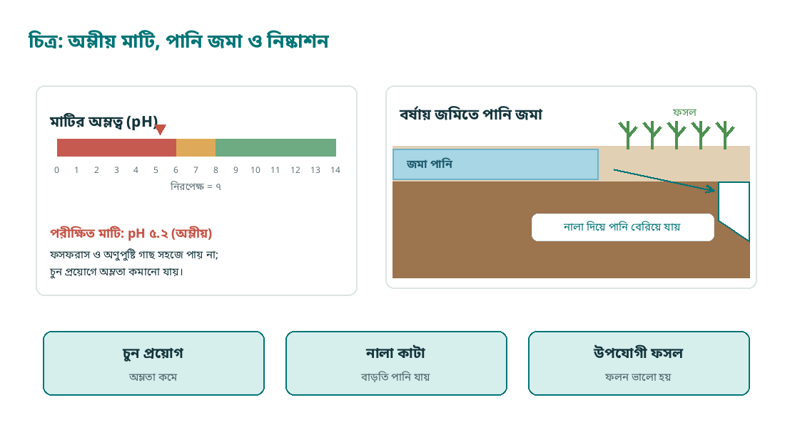

*চিত্র–১.১: অম্লীয় মাটির pH, পানি জমা ও নিষ্কাশন নালা*

- **ক.** মাটির pH কী? **[১]**
- **খ.** কৃষির জন্য দোআঁশ মাটি উত্তম কেন? **[২]**
- **গ.** উদ্দীপকের জমিতে সৃষ্ট সমস্যা ও কৃষি কর্মকর্তার পরামর্শ ব্যাখ্যা করো। **[৩]**
- **ঘ.** ফসল নির্বাচনে মাটির প্রকৃতি ও পানি নিষ্কাশনের প্রভাব বিশ্লেষণ করো। **[৪]**

**২।** সালমা বীজতলায় ১০০টি টমেটো বীজ বপন করে ৮০টি চারা পান—চিত্রে ফলাফলটি দেখানো হয়েছে। যে বীজগুলো আর্দ্র অবস্থায় বায়ুরোধী পাত্রে রাখা হয়েছিল, সেগুলোতে ছত্রাক ধরে নষ্ট হয়ে যায়।

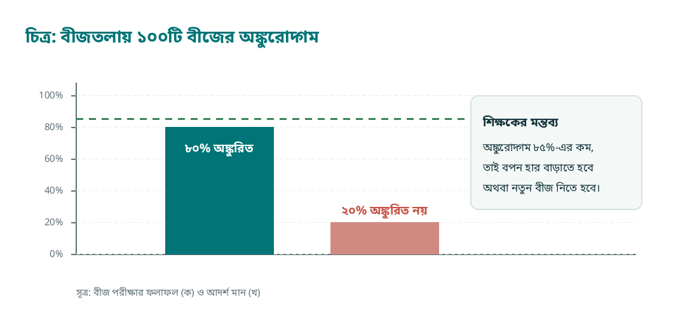

*চিত্র–১.২: ১০০টি বীজের অঙ্কুরোদ্গম ও আদর্শ মান*

- **ক.** বীজের অঙ্কুরোদ্গম ক্ষমতা কাকে বলে? **[১]**
- **খ.** ভালো বীজের দুটি বৈশিষ্ট্য লেখো। **[২]**
- **গ.** উদ্দীপকের বীজের গুণাগুণ ব্যাখ্যা করো। **[৩]**
- **ঘ.** আর্দ্র বীজ সংরক্ষণে সমস্যা ও তার প্রতিকার বিশ্লেষণ করো। **[৪]**

**৩।** আব্দুল করিম এক একর জমিতে বছরের পর বছর শুধু ইউরিয়া সার প্রয়োগ করেন। ফলন কমতে থাকলে কৃষি কর্মকর্তা মাটি পরীক্ষা করে ইউরিয়া, টিএসপি, মিউরেট অব পটাশ ও জিংক সালফেট সুষমভাবে প্রয়োগ এবং জৈব সার ব্যবহারের পরামর্শ দেন।

- **ক.** সার কী? **[১]**
- **খ.** জৈব সার ব্যবহারের দুটি সুবিধা লেখো। **[২]**
- **গ.** উদ্দীপকের আলোকে সুষম সার প্রয়োগ ব্যাখ্যা করো। **[৩]**
- **ঘ.** কেবল ইউরিয়ার ওপর নির্ভরতা ফসল ও মাটির স্বাস্থ্যে কী প্রভাব ফেলে—বিশ্লেষণ করো। **[৪]**

**৪।** গ্রামে গবাদিপশুর গোবর ও কচুরিপানা পুকুরপাড়ে স্তূপ করে ফেলা হতো; দুর্গন্ধ ছড়াত, মশার উপদ্রব বাড়ছিল। এক যুবক এসব বর্জ্য দিয়ে কম্পোস্ট ও বায়োগ্যাস তৈরি শুরু করেন এবং সবজি চাষে সেই জৈব সার ব্যবহার করেন।

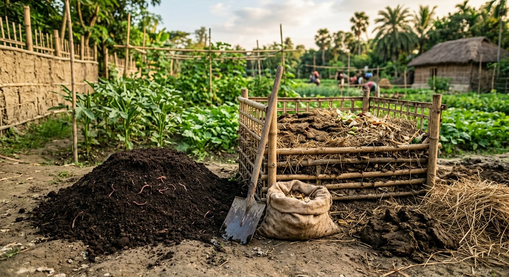

*ছবি–১.৩: গোবর ও কৃষিবর্জ্য দিয়ে কম্পোস্ট তৈরি (উদাহরণমূলক ছবি)*

- **ক.** কম্পোস্ট কী? **[১]**
- **খ.** বায়োগ্যাসের প্রধান উপাদান কী? **[২]**
- **গ.** উদ্দীপকের উদ্যোগে সার ও জ্বালানির সমস্যা কীভাবে সমাধান হলো—ব্যাখ্যা করো। **[৩]**
- **ঘ.** কৃষিতে জৈব সারের ব্যবহার বাড়ানো কেন প্রয়োজন—বিশ্লেষণ করো। **[৪]**

**৫।** পেয়ারা বাগানে পোকার আক্রমণে কৃষক প্রতি সপ্তাহে কীটনাশক স্প্রে করছিলেন, তবু পোকার সংখ্যা কমছিল না; বরং উপকারী পোকা ও মৌমাছি মরে যাচ্ছিল। কৃষি কর্মকর্তা ফেরোমন ফাঁদ, আলোক ফাঁদ এবং পরজীবী পোকা ছাড়ার পরামর্শ দেন।

- **ক.** সমন্বিত বালাই ব্যবস্থাপনা (IPM) কী? **[১]**
- **খ.** ফেরোমন ফাঁদ কীভাবে কাজ করে? **[২]**
- **গ.** উদ্দীপকে গৃহীত পদ্ধতিগুলো ব্যাখ্যা করো। **[৩]**
- **ঘ.** অতিরিক্ত কীটনাশক ব্যবহারের ক্ষতিকর দিক বিশ্লেষণ করো। **[৪]**

**৬।** একটি পুকুরের পানি শুকিয়ে কাদা তুলে ফেলা হলো, জলজ আগাছা পরিষ্কার করা হলো, এরপর চুন ও গোবর প্রয়োগ করে রাক্ষুসে মাছ দমন করা হলো। কিছুদিন পর পোনা ছাড়া হয় এবং নিয়মিত সম্পূরক খাদ্য দেওয়া শুরু হয়।

- **ক.** পুকুর কাকে বলে? **[১]**
- **খ.** পুকুরে চুন প্রয়োগের দুটি উপকারিতা লেখো। **[২]**
- **গ.** উদ্দীপকের পুকুর প্রস্তুতির ধাপগুলো ব্যাখ্যা করো। **[৩]**
- **ঘ.** পুকুর প্রস্তুতি ছাড়া পোনা ছাড়লে কী কী সমস্যা হতে পারে—বিশ্লেষণ করো। **[৪]**

**৭।** খামারি বশির গাভীকে শুধু শুকনো খড় খাওয়াতেন; দুধ উৎপাদন কমে যায় এবং গাভী দুর্বল হয়ে পড়ে। উপজেলা প্রাণিসম্পদ কর্মকর্তা চিত্রে দেখানো খাদ্যতালিকা অনুসরণ এবং পরিষ্কার পানি খাওয়ানোর পরামর্শ দেন।

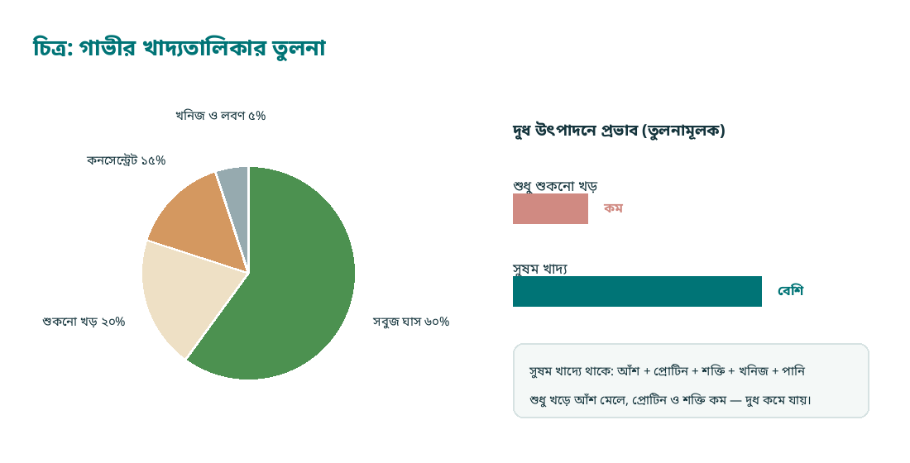

*চিত্র–১.৪: গাভীর সুষম খাদ্যতালিকা ও দুধে তার প্রভাব*

- **ক.** সাইলেজ কী? **[১]**
- **খ.** গাভীকে সবুজ ঘাস খাওয়ানো কেন প্রয়োজন? **[২]**
- **গ.** উদ্দীপকের খাদ্যতালিকায় কোন কোন উপাদান যোগ করলে তা সুষম খাদ্য হবে—ব্যাখ্যা করো। **[৩]**
- **ঘ.** কেবল খড় খাওয়ালে দুধ উৎপাদনে কী প্রভাব পড়ে—বিশ্লেষণ করো। **[৪]**

**৮।** উপকূলীয় একটি গ্রামে লবণাক্ততা বেড়ে যাওয়ায় আগের ধানের জাতগুলোতে ফলন কমে যায়। কৃষি কর্মকর্তা লবণাক্ততা সহনশীল জাত ব্যবহার, জমির উঁচু অংশে বীজতলা তৈরি এবং লবণাক্ত পানিতে চিংড়ি চাষের পরামর্শ দেন।

- **ক.** লবণাক্ততা সহনশীল ফসল কী? **[১]**
- **খ.** উপকূলে লবণাক্ততা বাড়ার দুটি কারণ লেখো। **[২]**
- **গ.** উদ্দীপকের কৃষকের জন্য প্রযোজ্য অভিযোজন কৌশল ব্যাখ্যা করো। **[৩]**
- **ঘ.** জলবায়ু পরিবর্তনের প্রভাব মোকাবিলায় কৃষিপ্রযুক্তির ভূমিকা বিশ্লেষণ করো। **[৪]**

## গ-বিভাগ: সংক্ষিপ্ত উত্তর — ১০ নম্বর

৮টি প্রশ্ন থেকে যেকোনো ৫টির উত্তর দাও। প্রতিটির মান ২।

১. কৃষি প্রযুক্তি বলতে কী বোঝায়?  [২]  
২. মাটির উর্বরতা বলতে কী বোঝায়?  [২]  
৩. ভালো বীজের দুটি বৈশিষ্ট্য লেখো।  [২]  
৪. সুষম সার প্রয়োগ কেন প্রয়োজন?  [২]  
৫. সমন্বিত বালাই ব্যবস্থাপনার দুটি পদ্ধতি লেখো।  [২]  
৬. পুকুরে চুন প্রয়োগের দুটি উপকারিতা লেখো।  [২]  
৭. খরা সহনশীল দুটি ফসলের নাম লেখো।  [২]  
৮. জলবায়ু পরিবর্তনের দুটি প্রভাব লেখো।  [২]  

---
# সেট–২

**তত্ত্বীয় পূর্ণমান ৭৫ | প্রস্তাবিত সময় ২ ঘণ্টা ৩০ মিনিট**

## ক-বিভাগ: বহুনির্বাচনি অভীক্ষা — ২৫ নম্বর

সবগুলো প্রশ্নের উত্তর দাও। প্রতিটি প্রশ্নের মান ১। সময় ২৫ মিনিট।

**১। বাংলাদেশে সবচেয়ে বেশি জমিতে চাষ করা ফসল কোনটি?**
ক) গম  |  খ) পাট  |  গ) ধান  |  ঘ) আলু

**২। আউশ ধান বপন বা রোপণের উপযুক্ত সময় কোনটি?**
ক) নভেম্বর–ডিসেম্বর  |  খ) মার্চ–এপ্রিল  |  গ) জুন–জুলাই  |  ঘ) সেপ্টেম্বর–অক্টোবর

**৩। বোরো ধান কর্তনের সময় কোনটি?**
ক) এপ্রিল–মে  |  খ) জুলাই–আগস্ট  |  গ) অক্টোবর–নভেম্বর  |  ঘ) ডিসেম্বর–জানুয়ারি

**৪। গম বপনের সবচেয়ে উপযুক্ত সময় কোনটি?**
ক) জুন  |  খ) সেপ্টেম্বর  |  গ) মধ্য নভেম্বর  |  ঘ) ফেব্রুয়ারি

**৫। পাটের বীজ বপন করা হয় সাধারণত—**
ক) জানুয়ারি–ফেব্রুয়ারি  |  খ) মার্চ–এপ্রিল  |  গ) আগস্ট–সেপ্টেম্বর  |  ঘ) নভেম্বর–ডিসেম্বর

**৬। আলু রোপণের উপযুক্ত সময় কোনটি?**
ক) মার্চ–এপ্রিল  |  খ) জুন–জুলাই  |  গ) নভেম্বর  |  ঘ) সেপ্টেম্বর

**৭। ধানের পর বাংলাদেশের দ্বিতীয় প্রধান খাদ্যশস্য কোনটি?**
ক) ভুট্টা  |  খ) গম  |  গ) আলু  |  ঘ) ডাল

**৮। উন্নত জাতের আম গাছে চারা তৈরি করতে প্রধানত কোন পদ্ধতি ব্যবহার করা হয়?**
ক) বীজ বপন  |  খ) পাতা লাগানো  |  গ) মূল কাটিং  |  ঘ) জোড়কলম (গ্রাফটিং)

**৯। নার্সারিতে চারা উৎপাদনে সবচেয়ে বেশি ব্যবহৃত হয় কোনটি?**
ক) কাগজের ঠোঙা  |  খ) পলিব্যাগ  |  গ) কাঠের বাক্স  |  ঘ) কাঁচের পাত্র

**১০। মাশরুম চাষে প্রধান কাঁচামাল হিসেবে ব্যবহৃত হয়—**
ক) ধানের খড়  |  খ) মাটির ঢেলা  |  গ) পাটকাঠি  |  ঘ) ইটের গুঁড়া

**১১। মিশ্র মাছ চাষে পানির উপরের স্তরে খাদ্য গ্রহণ করে কোন মাছ?**
ক) মৃগেল  |  খ) রুই  |  গ) কাতলা  |  ঘ) শিং

**১২। দ্রুত বর্ধনশীল ও বেশি ঘনত্বে চাষযোগ্য মাছ কোনটি?**
ক) পাঙাশ  |  খ) কৈ  |  গ) মৃগেল  |  ঘ) ইলিশ

**১৩। ব্রয়লার মুরগি সাধারণত বাজারে বিক্রির উপযোগী হয় কত দিনে?**
ক) ১৫–২০ দিনে  |  খ) ১৫০ দিনে  |  গ) ৯০–১০০ দিনে  |  ঘ) ৪০–৪৫ দিনে

**১৪। লেয়ার মুরগি পালন করা হয়—**
ক) মাংস উৎপাদনের জন্য  |  খ) ডিম উৎপাদনের জন্য  |  গ) পালক উৎপাদনের জন্য  |  ঘ) কেবল সার উৎপাদনের জন্য

**১৫। দুধ উৎপাদনে সর্বাধিক খ্যাতিমান বিদেশি গরুর জাত কোনটি?**
ক) শাহীওয়াল  |  খ) ফ্রিজিয়ান  |  গ) ব্রাহমা  |  ঘ) দেশি গরু

**১৬। দুধ ও মাংস—উভয় উৎপাদনের জন্য উপযোগী গরুর জাত কোনটি?**
ক) শাহীওয়াল  |  খ) হলস্টেইন  |  গ) জার্সি  |  ঘ) ব্রাহমা

**১৭। একই জমিতে গাছ ও ফসল একসঙ্গে উৎপাদনকে কী বলে?**
ক) কৃষি বনায়ন  |  খ) একক ফসল চাষ  |  গ) জলজ চাষ  |  ঘ) মিশ্র সার প্রয়োগ

**১৮। সুন্দরবনের প্রধান বৃক্ষ কোনটি?**
ক) মেহগনি  |  খ) সুন্দরী  |  গ) সেগুন  |  ঘ) আকাশমণি

**১৯। উপকূলীয় অঞ্চলে ম্যানগ্রোভ বন প্রধানত কোনটি থেকে রক্ষা করে?**
ক) খরা  |  খ) শিলাবৃষ্টি  |  গ) ভূমিকম্প  |  ঘ) জলোচ্ছ্বাস ও ঘূর্ণিঝড়

**২০। সামাজিক বনায়নের প্রধান বৈশিষ্ট্য কোনটি?**
ক) কেবল বন বিভাগের চারা রোপণ  |  খ) জনগণের অংশগ্রহণে বনায়ন ও সুফল বণ্টন  |  গ) কেবল গাছ কাটা  |  ঘ) শুধু ফলগাছ লাগানো

**২১। কৃষি বনায়নের উদাহরণ কোনটি?**
ক) কেবল ধান চাষ  |  খ) কেবল বনভূমি সংরক্ষণ  |  গ) পুকুরপাড়ে নারকেল ও সবজি চাষ  |  ঘ) শুধু গবাদিপশু পালন

**২২। ড্রিপ সেচ পদ্ধতির প্রধান সুবিধা কোনটি?**
ক) বেশি পানি প্রয়োজন হয়  |  খ) আগাছা বেশি জন্মায়  |  গ) মাটি দ্রুত শুকিয়ে যায়  |  ঘ) পানি ও সার সাশ্রয় হয়

**২৩। ফসলের গোড়ায় মাটি তুলে দেওয়াকে কী বলে?**
ক) আগাছা দমন  |  খ) রগিং  |  গ) হাম পুলিং  |  ঘ) মালচিং

**২৪। মাটির আর্দ্রতা রক্ষা ও আগাছা দমনে সহায়ক পদ্ধতি কোনটি?**
ক) মালচিং  |  খ) গভীর কর্ষণ  |  গ) অতিরিক্ত সেচ  |  ঘ) বীজ বপন

**২৫। ঢালু জমিতে মাটির ক্ষয় রোধে যে পদ্ধতি অনুসরণ করা হয়—**
ক) ঢালের সমান্তরালে লম্বা ফুরো কাটা  |  খ) পানি নিষ্কাশন বন্ধ রাখা  |  গ) সব গাছ কেটে ফেলা  |  ঘ) সমোন্নতি রেখা বরাবর চাষ করা

## খ-বিভাগ: সৃজনশীল প্রশ্ন — ৪০ নম্বর

৮টি প্রশ্ন থেকে যেকোনো ৪টির উত্তর দাও। প্রতিটির মান ১০; ক = ১, খ = ২, গ = ৩, ঘ = ৪।

**১।** রফিক মিয়া বোরো মৌসুমে ধান চাষ করেন। তিনি ডিসেম্বরে চারা রোপণ করেন, জানুয়ারি থেকে মার্চ পর্যন্ত জমিতে অগভীর পানি ধরে রাখেন এবং এপ্রিলের শেষে ধান কর্তন করেন। চিত্রে মৌসুমের কাজগুলো সময় অনুযায়ী সাজানো হয়েছে।

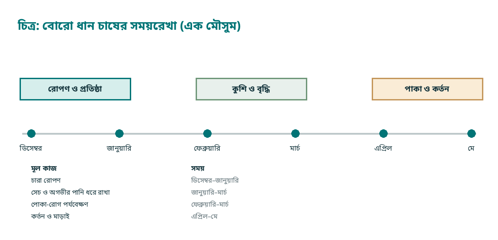

*চিত্র–২.১: বোরো ধান চাষের সময়রেখা*

- **ক.** বোরো ধান কী? **[১]**
- **খ.** ধান চাষে বীজতলা তৈরি করা প্রয়োজন কেন? **[২]**
- **গ.** উদ্দীপকের তথ্যের ভিত্তিতে রফিকের ধান চাষ পদ্ধতি ব্যাখ্যা করো। **[৩]**
- **ঘ.** ধান চাষে সঠিক সময়ে রোপণ ও পানি ব্যবস্থাপনার গুরুত্ব বিশ্লেষণ করো। **[৪]**

**২।** আলু চাষি মজিদ মিয়া ৩০ দিন বয়সে গাছের গোড়ায় মাটি তুলে দিলেন, ফলে কন্দগুলো মাটির নিচে সুস্থভাবে বড় হলো। তিনি বীজ আলু কেটে ছাই মাখিয়ে রোপণ করেন এবং জমিতে নাইট্রোজেন সার প্রয়োগে সতর্ক থাকেন।

- **ক.** হাম পুলিং কী? **[১]**
- **খ.** কাটা বীজ আলু ব্যবহারের একটি সুবিধা লেখো। **[২]**
- **গ.** উদ্দীপকে আলু চাষে অনুসৃত পদ্ধতিগুলো ব্যাখ্যা করো। **[৩]**
- **ঘ.** আলু চাষে নাইট্রোজেন সারের অতিরিক্ত ব্যবহার ক্ষতিকর কেন—বিশ্লেষণ করো। **[৪]**

**৩।** সুমন আম, লিচু ও লেবুর চারা তৈরি করতে বীজ বপন না করে মাতৃগাছের ডাল ব্যবহার করেন। তিনি জোড়কলমের ধাপ অনুসরণ করে চারা তৈরি করেন, পলিব্যাগে রেখে ছায়ায় পরিচর্যা করেন এবং পরে মূল জমিতে রোপণ করেন।

- **ক.** জোড়কলম (কলম) কী? **[১]**
- **খ.** কলমের দুটি সুবিধা লেখো। **[২]**
- **গ.** উদ্দীপকে সুমনের অনুসৃত চারা উৎপাদন পদ্ধতি ব্যাখ্যা করো। **[৩]**
- **ঘ.** বীজ থেকে চারা তৈরি ও কলমের মধ্যে তুলনামূলক বিশ্লেষণ করো। **[৪]**

**৪।** একটি পুকুরে রুই, কাতলা ও মৃগেল একসঙ্গে চাষ করা হয়—চিত্রে তাদের খাদ্য গ্রহণের স্তর দেখানো হয়েছে। পুকুরে নিয়মিত গোবর ও অন্যান্য সার প্রয়োগ করা হয় এবং মাছকে সম্পূরক খাদ্য দেওয়া হয়। বছর শেষে মালিক একই পুকুর থেকে আগের চেয়ে অনেক বেশি মাছ পান।

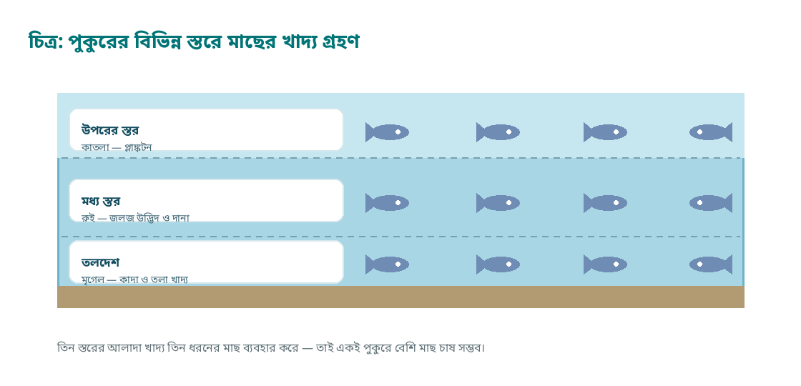

*চিত্র–২.২: পুকুরের বিভিন্ন স্তরে মাছের খাদ্য গ্রহণ*

- **ক.** মিশ্র মাছ চাষ কী? **[১]**
- **খ.** পুকুরের প্রাকৃতিক খাদ্য বলতে কী বোঝায়? **[২]**
- **গ.** উদ্দীপকের তিন ধরনের মাছ পুকুরের কোন স্তরে খাদ্য গ্রহণ করে—ব্যাখ্যা করো। **[৩]**
- **ঘ.** মিশ্র মাছ চাষ লাভজনক কেন—বিশ্লেষণ করো। **[৪]**

**৫।** একটি ব্রয়লার খামারে ৫০০টি বাচ্চা আনা হলো। প্রথম সপ্তাহে ঘরে নির্দিষ্ট তাপমাত্রা ও আলো দেওয়া হলো, লিটার বিছিয়ে রাখা হলো, নির্দিষ্ট বয়সে টিকা দেওয়া হলো এবং নিয়মিত সুষম খাদ্য ও পরিষ্কার পানি দেওয়া হলো। ছবিতে এমনই একটি খামারের ঘর দেখানো হয়েছে।

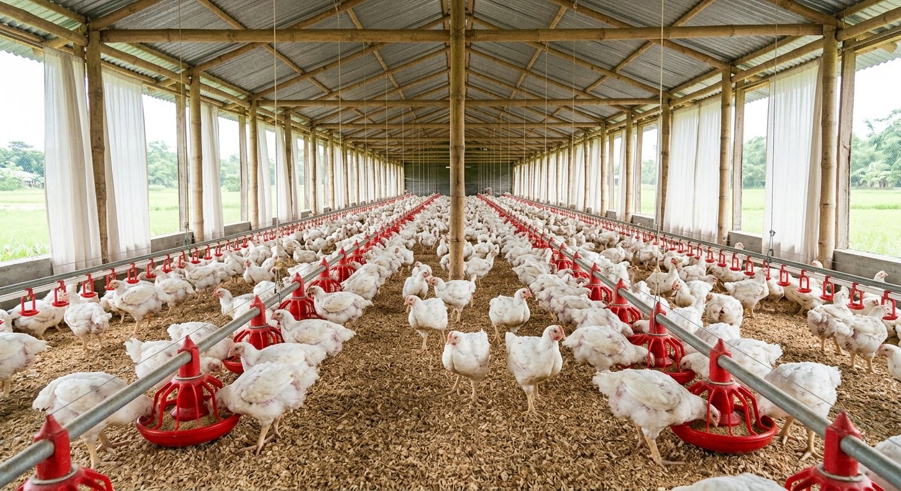

*ছবি–২.৩: ব্রয়লার মুরগির ঘরে লিটার, ফিডার ও পানির লাইন (উদাহরণমূলক ছবি)*

- **ক.** ব্রুডিং কী? **[১]**
- **খ.** মুরগির ঘরে লিটার রাখা প্রয়োজন কেন? **[২]**
- **গ.** উদ্দীপকের খামারে অনুসৃত ব্যবস্থাপনা ব্যাখ্যা করো। **[৩]**
- **ঘ.** ব্রয়লার খামারে রোগ প্রতিরোধ ও লাভজনকতার সম্পর্ক বিশ্লেষণ করো। **[৪]**

**৬।** এক কৃষক নিজের জমির চারপাশে রাস্তার পাশে গাছ লাগালেন, পুকুরপাড়ে নারকেল ও সবজি চাষ করলেন এবং জমিতে মেহগনির চারা ও ধান একসঙ্গে চাষ করলেন। কয়েক বছর পর তাঁর আয় বেড়ে যায় এবং জমির মাটিও ভালো হয়।

- **ক.** কৃষি বনায়ন কী? **[১]**
- **খ.** বনায়ন মাটির ক্ষয় রোধ করে কীভাবে? **[২]**
- **গ.** উদ্দীপকে কৃষি বনায়নের ধরনগুলো ব্যাখ্যা করো। **[৩]**
- **ঘ.** বনায়ন পরিবেশ ও কৃষকের অর্থনীতিতে কী ভূমিকা রাখে—বিশ্লেষণ করো। **[৪]**

**৭।** শুষ্ক মৌসুমে সবজি বাগানে পানির সংকট দেখা দিলে কৃষক চিত্রে দেখানো ড্রিপ পদ্ধতিতে গাছের গোড়ায় ফোঁটা ফোঁটা পানি দিতে শুরু করেন। পাশাপাশি জমিতে মালচিং করা হলো; ফলে আগের চেয়ে কম পানিতেই ভালো ফলন পাওয়া গেল।

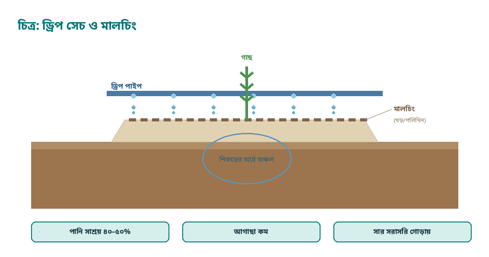

*চিত্র–২.৪: ড্রিপ সেচ ও মালচিং*

- **ক.** সেচ কী? **[১]**
- **খ.** ড্রিপ সেচে পানি সাশ্রয় হয় কেন? **[২]**
- **গ.** উদ্দীপকে অনুসৃত সেচ ও পরিচর্যা পদ্ধতি ব্যাখ্যা করো। **[৩]**
- **ঘ.** শুষ্ক মৌসুমে ফসল উৎপাদনে সেচের গুরুত্ব ও অপচয় রোধের উপায় বিশ্লেষণ করো। **[৪]**

**৮।** একটি পরিবার সারা বছর সবজি খেতে চায়। তারা উঠানের পাশে উঁচু বেড তৈরি করে টমেটো, বাঁধাকপি ও লাউয়ের চারা রোপণ করেন। ভালো ফলনের জন্য বীজ সরাসরি না বুনে নার্সারিতে সুস্থ চারা তৈরি করে নেওয়ার পরামর্শ দেন কৃষি কর্মকর্তা।

- **ক.** নার্সারি কী? **[১]**
- **খ.** সবজি চাষে মালচিং-এর দুটি উপকারিতা লেখো। **[২]**
- **গ.** উদ্দীপকের সবজি চাষ পদ্ধতি ব্যাখ্যা করো। **[৩]**
- **ঘ.** সারা বছর সবজি সরবরাহে পরিকল্পিত চাষের গুরুত্ব বিশ্লেষণ করো। **[৪]**

## গ-বিভাগ: সংক্ষিপ্ত উত্তর — ১০ নম্বর

৮টি প্রশ্ন থেকে যেকোনো ৫টির উত্তর দাও। প্রতিটির মান ২।

১. ধানের মৌসুমগুলো ও তাদের একটি বৈশিষ্ট্য লেখো।  [২]  
২. গম চাষের উপযুক্ত সময় ও একটি উন্নত জাতের নাম লেখো।  [২]  
৩. হাম পুলিং কী এবং কেন করা হয়?  [২]  
৪. কলমের দুটি সুবিধা লেখো।  [২]  
৫. মিশ্র মাছ চাষ বলতে কী বোঝায়?  [২]  
৬. ব্রয়লার ও লেয়ার মুরগির একটি পার্থক্য লেখো।  [২]  
৭. কৃষি বনায়নের দুটি সুবিধা লেখো।  [২]  
৮. ড্রিপ সেচের দুটি সুবিধা লেখো।  [২]  

---
# সেট–৩

**তত্ত্বীয় পূর্ণমান ৭৫ | প্রস্তাবিত সময় ২ ঘণ্টা ৩০ মিনিট**

## ক-বিভাগ: বহুনির্বাচনি অভীক্ষা — ২৫ নম্বর

সবগুলো প্রশ্নের উত্তর দাও। প্রতিটি প্রশ্নের মান ১। সময় ২৫ মিনিট।

**১। কৃষি সমবায়ের মূল উদ্দেশ্য কোনটি?**
ক) কেবল ব্যক্তিগত মুনাফা  |  খ) সদস্যদের অর্থনৈতিক ও সামাজিক উন্নয়ন  |  গ) সরকারি কর বৃদ্ধি  |  ঘ) কেবল ঋণ বিতরণ

**২। সমবায় সমিতিতে ভোটাধিকার নির্ধারিত হয় কীভাবে?**
ক) পুঁজির অনুপাতে  |  খ) এক সদস্য এক ভোট  |  গ) সভাপতির ইচ্ছা অনুযায়ী  |  ঘ) জমির পরিমাণ অনুযায়ী

**৩। সমবায়ের সদস্যপদ গ্রহণ হয়—**
ক) বাধ্যতামূলকভাবে  |  খ) স্বেচ্ছামূলকভাবে  |  গ) কেবল ধনীদের জন্য  |  ঘ) কেবল সরকারি কর্মকর্তাদের জন্য

**৪। কৃষকদের সেচের পাম্প ও যন্ত্রপাতি ভাগ করে ব্যবহার করা কোন ধরনের সুবিধা?**
ক) সমবায়ের  |  খ) একক খামারের  |  গ) আমদানি বাণিজ্যের  |  ঘ) কর হ্রাসের

**৫। বাংলাদেশে সমবায় সমিতি নিবন্ধিত হয় কোন প্রতিষ্ঠানের অধীনে?**
ক) সমবায় অধিদপ্তর  |  খ) নির্বাচন কমিশন  |  গ) শিক্ষা বোর্ড  |  ঘ) পরিবার পরিকল্পনা অধিদপ্তর

**৬। কৃষি ঋণের একটি প্রধান উৎস কোনটি?**
ক) বাংলাদেশ কৃষি ব্যাংক  |  খ) সুপ্রিম কোর্ট  |  গ) জাতীয় সংসদ  |  ঘ) বিদ্যালয় পরিচালনা কমিটি

**৭। পারিবারিক খামারের প্রধান বৈশিষ্ট্য কোনটি?**
ক) শুধু বাণিজ্যিক বিনিয়োগে পরিচালিত হয়  |  খ) পারিবারিক শ্রম ও পুঁজির সমন্বয়ে পরিচালিত হয়  |  গ) কেবল রপ্তানির জন্য উৎপাদন করে  |  ঘ) কোনো আয়-ব্যয় হিসাব রাখা হয় না

**৮। পারিবারিক খামার পরিকল্পনার প্রথম ধাপ কোনটি?**
ক) ঋণ গ্রহণ  |  খ) লক্ষ্য নির্ধারণ ও সম্ভাব্যতা যাচাই  |  গ) বাজারজাতকরণ  |  ঘ) পোকা দমন

**৯। খামারের আয়-ব্যয়ের হিসাব রাখার প্রধান উপকারিতা কী?**
ক) লাভ-ক্ষতি ও ব্যয়ের খাত বোঝা যায়  |  খ) পোকার সংখ্যা বাড়ে  |  গ) মাটির pH বাড়ে  |  ঘ) বৃষ্টিপাত বাড়ে

**১০। সমন্বিত খামারে গোবর থেকে তৈরি হয়—**
ক) পলিব্যাগ  |  খ) কীটনাশক  |  গ) বায়োগ্যাস ও জৈব সার  |  ঘ) বীজ

**১১। পারিবারিক পুকুরে মাছের সঙ্গে হাঁস পালন করলে—  i. পুকুরে জৈব সার যোগ হয়; ii. হাঁসের খাদ্য খরচ কমে; iii. পানির অক্সিজেন সম্পূর্ণ শেষ হয়ে যায়। নিচের কোনটি সঠিক?**
ক) i ও iii  |  খ) ii ও iii  |  গ) i ও ii  |  ঘ) i, ii ও iii

**১২। পারিবারিক খামারে পুকুরপাড়ে সবজি চাষের প্রধান সুবিধা কী?**
ক) মাছ মরে যায়  |  খ) পুকুর দ্রুত শুকিয়ে যায়  |  গ) জমির অপচয় রোধ ও অতিরিক্ত আয়  |  ঘ) সেচ বন্ধ হয়ে যায়

**১৩। ব্রয়লার মুরগির ঘরে আলো দেওয়া হয় প্রধানত—**
ক) খাদ্য গ্রহণ ও দ্রুত বৃদ্ধির জন্য  |  খ) ডিম পাড়ার জন্য  |  গ) পালকের রং বদলাতে  |  ঘ) শব্দ কমানোর জন্য

**১৪। মুরগিকে টিকা (ভ্যাকসিন) দেওয়া হয়—**
ক) খাদ্য হজম করাতে  |  খ) ওজন বাড়ানোর জন্য  |  গ) ডিমের রং বদলাতে  |  ঘ) রোগ প্রতিরোধের জন্য

**১৫। গাভীর দুধ উৎপাদন বাড়াতে সবচেয়ে গুরুত্বপূর্ণ কোনটি?**
ক) কেবল ঘরের আলো  |  খ) কেবল শুকনো খড়  |  গ) কেবল লবণ  |  ঘ) সুষম খাদ্য ও পর্যাপ্ত পরিষ্কার পানি

**১৬। দুধ সংরক্ষণের আধুনিক পদ্ধতি কোনটি?**
ক) খোলা পাত্রে রাখা  |  খ) রোদে শুকানো  |  গ) পাস্তুরিকরণ ও হিমায়ন  |  ঘ) কাদায় রাখা

**১৭। মাছ সংরক্ষণের ঐতিহ্যবাহী পদ্ধতি কোনটি?**
ক) মাটিতে পোতা  |  খ) খোলা আকাশে রাখা  |  গ) পানিতে ভিজিয়ে রাখা  |  ঘ) শুটকি তৈরি ও লবণ প্রয়োগ

**১৮। কৃষিপণ্যের বাজারজাতকরণে সমবায়ের প্রধান ভূমিকা কী?**
ক) কেবল ঋণ দেওয়া  |  খ) পণ্যের মান কমিয়ে দেওয়া  |  গ) মধ্যস্বত্বভোগীর প্রভাব কমিয়ে ন্যায্য দাম নিশ্চিত করা  |  ঘ) উৎপাদন বন্ধ করা

**১৯। খামারের সফলতার মূল নির্ধারক কোনটি?**
ক) কেবল জমির আয়তন  |  খ) কেবল ভাগ্য  |  গ) কেবল ঋণের পরিমাণ  |  ঘ) সুষ্ঠু পরিকল্পনা ও হিসাব রক্ষণ

**২০। পারিবারিক খামারে নারীর ভূমিকা সম্পর্কে সঠিক বক্তব্য কোনটি?**
ক) কেবল বিনোদনমূলক  |  খ) কেবল হিসাব লেখা  |  গ) কোনো ভূমিকা নেই  |  ঘ) সবজি, পোল্ট্রি ও দুধ উৎপাদনে গুরুত্বপূর্ণ অংশগ্রহণ

**২১। আগাছা দমন, সার প্রয়োগ ও সেচ—এসব কাজকে একত্রে কী বলা হয়?**
ক) আন্তঃপরিচর্যা  |  খ) বাজারজাতকরণ  |  গ) বীজ সংরক্ষণ  |  ঘ) বীজ প্রক্রিয়াকরণ

**২২। মাটি পরীক্ষা করানোর প্রধান উপকারিতা কী?**
ক) আগাছা বেড়ে যায়  |  খ) ফসলের রং বদলে যায়  |  গ) সঠিক মাত্রায় সার প্রয়োগ করা যায়  |  ঘ) সেচ কম লাগে

**২৩। কৃষিতে "সবুজ বিপ্লব" বলতে বোঝায়—**
ক) উচ্চফলনশীল জাত ও আধুনিক প্রযুক্তির ব্যবহার  |  খ) কেবল গাছ লাগানো  |  গ) কেবল জৈব চাষ  |  ঘ) কেবল সেচ সম্প্রসারণ

**২৪। খাদ্য নিরাপত্তার সঙ্গে সম্পর্কিত—  i. পর্যাপ্ত উৎপাদন; ii. পুষ্টিমান; iii. খাদ্যের বিষমুক্ততা। নিচের কোনটি সঠিক?**
ক) i ও ii  |  খ) ii ও iii  |  গ) i ও iii  |  ঘ) i, ii ও iii

**২৫। খামারবর্জ্য পরিবেশবান্ধবভাবে ব্যবহারের উদাহরণ কোনটি?**
ক) গোবর দিয়ে বায়োগ্যাস ও কম্পোস্ট তৈরি  |  খ) বর্জ্য নদীতে ফেলা  |  গ) খড় পুড়িয়ে ফেলা  |  ঘ) পলিথিন মাটিতে পোতা

## খ-বিভাগ: সৃজনশীল প্রশ্ন — ৪০ নম্বর

৮টি প্রশ্ন থেকে যেকোনো ৪টির উত্তর দাও। প্রতিটির মান ১০; ক = ১, খ = ২, গ = ৩, ঘ = ৪।

**১।** একটি গ্রামের ৩০ জন কৃষক মিলে একটি সমিতি গঠন করেন। সমিতির নিয়ম—সদস্যপদ স্বেচ্ছামূলক, এক সদস্য এক ভোট এবং লভ্যাংশ সদস্যদের মধ্যে বণ্টিত হবে। তাঁরা একসঙ্গে সার ও বীজ কেনেন এবং নিজেদের পণ্য একসঙ্গে বাজারে বিক্রি করেন।

- **ক.** কৃষি সমবায় কী? **[১]**
- **খ.** "এক সদস্য এক ভোট" নীতির গুরুত্ব কী? **[২]**
- **গ.** উদ্দীপকের সমিতির কার্যক্রম ব্যাখ্যা করো। **[৩]**
- **ঘ.** কৃষকের আর্থসামাজিক উন্নয়নে কৃষি সমবায়ের ভূমিকা বিশ্লেষণ করো। **[৪]**

**২।** সালেহা বেগমের ২০ শতাংশ জমি, একটি গাভী ও একটি ছোট পুকুর আছে—চিত্রে সম্পদগুলো কীভাবে কাজে লাগানো যায় তা দেখানো হয়েছে। তিনি পারিবারিক খামার গড়তে চান, কিন্তু সুনির্দিষ্ট পরিকল্পনা নেই; ঋণ নেওয়ার আগে লাভ-ক্ষতির হিসাবও করতে চান।

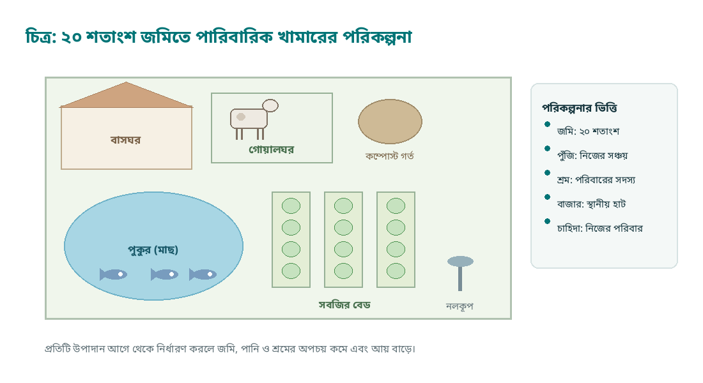

*চিত্র–৩.১: ২০ শতাংশ জমিতে পারিবারিক খামারের পরিকল্পনা*

- **ক.** পারিবারিক খামার কী? **[১]**
- **খ.** খামার পরিকল্পনায় স্থান নির্বাচন কেন গুরুত্বপূর্ণ? **[২]**
- **গ.** উদ্দীপকের সম্পদ ব্যবহার করে কীভাবে সমন্বিত খামার গড়া যায়—ব্যাখ্যা করো। **[৩]**
- **ঘ.** সফল খামারের জন্য পরিকল্পনা ও হিসাব রক্ষণ কেন প্রয়োজন—বিশ্লেষণ করো। **[৪]**

**৩।** একটি খামারে গাভিপালন, পুকুরে মাছ চাষ ও পুকুরপাড়ে সবজি চাষ একসঙ্গে করা হয়। গোবর পুকুরে ও সবজির জমিতে ব্যবহার করা হয়, পুকুরের পানি দিয়ে সবজিতে সেচ দেওয়া হয়—চিত্রে এই সম্পর্ক দেখানো হয়েছে। পরিবারের চাহিদা মিটিয়ে উদ্বৃত্ত পণ্য বাজারে বিক্রি হয়।

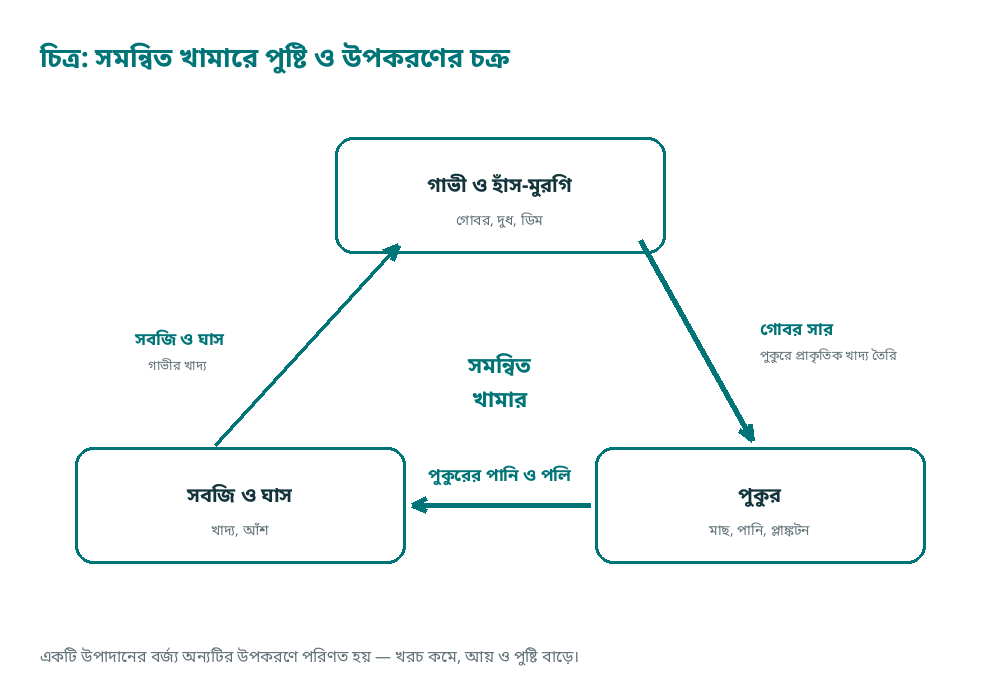

*চিত্র–৩.২: সমন্বিত খামারে পুষ্টি ও উপকরণের চক্র*

- **ক.** সমন্বিত খামার কী? **[১]**
- **খ.** পুকুরে গোবর প্রয়োগের উপকারিতা কী? **[২]**
- **গ.** উদ্দীপকের উপাদানগুলোর পারস্পরিক সম্পর্ক ব্যাখ্যা করো। **[৩]**
- **ঘ.** সমন্বিত খামার পারিবারিক আয় ও পুষ্টি—উভয়ের জন্য উপযোগী কেন—বিশ্লেষণ করো। **[৪]**

**৪।** কৃষক আলতাফ পাওয়ার টিলার ও সেচপাম্প কেনার জন্য ব্যাংক থেকে ঋণ নেন। ভালো ফলন হওয়ায় তিনি সময়মতো কিস্তি পরিশোধ করেন। পাশের কৃষকেরা ঋণ নিয়ে শখের কাজে ব্যয় করায় কিস্তি দিতে হিমশিম খাচ্ছেন।

- **ক.** কৃষি ঋণ কী? **[১]**
- **খ.** ঋণ নেওয়ার আগে কী কী বিবেচনা করা উচিত? **[২]**
- **গ.** উদ্দীপকে আলতাফের সফলতার কারণ ব্যাখ্যা করো। **[৩]**
- **ঘ.** কৃষি উন্নয়নে ঋণের গুরুত্ব এবং ঋণের অপব্যবহারের ঝুঁকি বিশ্লেষণ করো। **[৪]**

**৫।** একটি পরিবার প্রতিদিন প্রায় ৫০ লিটার দুধ উৎপাদন করে। স্থানীয় পাইকার কম দামে দুধ কিনে নেয়, ফলে পরিবারটি ক্ষতিগ্রস্ত হয়। পরে তারা চিত্রে দেখানো পথে সমবায়ের মাধ্যমে দুধ সংগ্রহ ও হিমায়িত পরিবহনের ব্যবস্থা করে ন্যায্য দাম পেতে শুরু করে।

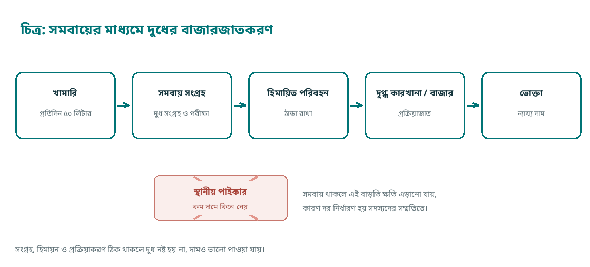

*চিত্র–৩.৩: সমবায়ের মাধ্যমে দুধের বাজারজাতকরণ*

- **ক.** বাজারজাতকরণ কী? **[১]**
- **খ.** দুধ দ্রুত নষ্ট হয় কেন? **[২]**
- **গ.** উদ্দীপকের সমস্যা সমাধানে সমবায়ের ভূমিকা ব্যাখ্যা করো। **[৩]**
- **ঘ.** কৃষিপণ্যের ন্যায্য মূল্য নিশ্চিত করতে সমবায় ও সংরক্ষণ ব্যবস্থা কেন প্রয়োজন—বিশ্লেষণ করো। **[৪]**

**৬।** একজন কৃষক মোবাইল ফোনে আবহাওয়ার পূর্বাভাস ও কৃষিবাজারের দর জানেন। ফলে তিনি বীজ বপন, সেচ ও পণ্য বিক্রির সময় নির্ধারণ করতে পারেন। পাশের অনেক কৃষক এসব তথ্য জানেন না বলে ঠিক সময়ে কাজ করতে পারেন না।

- **ক.** কৃষি তথ্য কী? **[১]**
- **খ.** কৃষকের জন্য আবহাওয়ার পূর্বাভাস জানা কেন প্রয়োজন? **[২]**
- **গ.** উদ্দীপকে তথ্যপ্রযুক্তির ব্যবহার কৃষিতে কীভাবে সহায়ক—ব্যাখ্যা করো। **[৩]**
- **ঘ.** ডিজিটাল কৃষিসেবার সম্ভাবনা ও সীমাবদ্ধতা বিশ্লেষণ করো। **[৪]**

**৭।** ধান কর্তনের পর কৃষক সঠিকভাবে না শুকিয়ে ছাদে ঢেরাই করে রাখেন। কয়েক মাস পর দেখা যায় ধানে পোকা ধরেছে এবং প্রায় ১৫% ধান নষ্ট হয়ে গেছে। কৃষি কর্মকর্তা শুকানো, পরিষ্কার পাত্র ও নিমপাতা-ছাই ব্যবহারের পরামর্শ দেন।

- **ক.** খাদ্যশস্য সংরক্ষণ কী? **[১]**
- **খ.** ধান সংরক্ষণের আগে শুকানো কেন প্রয়োজন? **[২]**
- **গ.** উদ্দীপকের ক্ষতি কমানোর উপায় ব্যাখ্যা করো। **[৩]**
- **ঘ.** খাদ্য নিরাপত্তায় সুষ্ঠু সংরক্ষণের ভূমিকা বিশ্লেষণ করো। **[৪]**

**৮।** রাসায়নিক সার ও কীটনাশকের অতিরিক্ত ব্যবহারে একটি জমির মাটি চাষের অযোগ্য হয়ে যাচ্ছিল। কৃষক পরে কম্পোস্ট, সবুজ সার ও সমন্বিত বালাই ব্যবস্থাপনা ব্যবহার শুরু করেন; কয়েক মৌসুমে মাটির উর্বরতা ফিরে আসে। চিত্রে দুই অবস্থার তুলনা দেওয়া হলো।

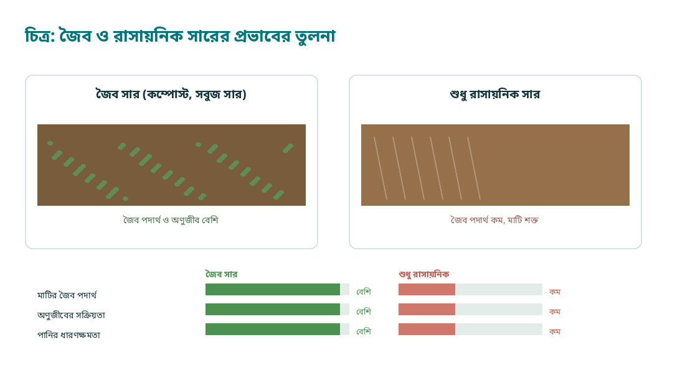

*চিত্র–৩.৪: জৈব ও রাসায়নিক সারের প্রভাবের তুলনা*

- **ক.** জৈব চাষ কী? **[১]**
- **খ.** সবুজ সার মাটির উর্বরতা বাড়ায় কীভাবে? **[২]**
- **গ.** উদ্দীপকের কৃষকের গৃহীত উদ্যোগ ব্যাখ্যা করো। **[৩]**
- **ঘ.** টেকসই কৃষির জন্য জৈব ও রাসায়নিক সারের ভারসাম্য কেন প্রয়োজন—বিশ্লেষণ করো। **[৪]**

## গ-বিভাগ: সংক্ষিপ্ত উত্তর — ১০ নম্বর

৮টি প্রশ্ন থেকে যেকোনো ৫টির উত্তর দাও। প্রতিটির মান ২।

১. কৃষি সমবায়ের দুটি নীতি লেখো।  [২]  
২. কৃষি সমবায়ের দুটি সুবিধা লেখো।  [২]  
৩. পারিবারিক খামার বলতে কী বোঝায়?  [২]  
৪. খামারের হিসাব রাখা প্রয়োজন কেন?  [২]  
৫. সমন্বিত খামারের দুটি উপকারিতা লেখো।  [২]  
৬. বায়োগ্যাস উৎপাদনের দুটি উপকারিতা লেখো।  [২]  
৭. দুধ সংরক্ষণের দুটি পদ্ধতির নাম লেখো।  [২]  
৮. কৃষিপণ্যের বাজারজাতকরণে দুটি সমস্যা লেখো।  [২]  

---

# বহুনির্বাচনি উত্তরমালা

প্রতিটি সেটের ২৫টি বহুনির্বাচনি প্রশ্নের সঠিক উত্তর নিচে দেওয়া; প্রথম বন্ধনীতে সংশ্লিষ্ট অধ্যায় নম্বর।

## সেট–১

১–গ (অধ্যায় ১)  |  ২–ঘ (১)  |  ৩–ক (১)  |  ৪–খ (৩)  |  ৫–ক (৩)  |  ৬–ক (৩)  |  ৭–গ (১)  |  ৮–গ (১)  |  ৯–ঘ (১)  |  ১০–খ (১)

১১–গ (২)  |  ১২–ঘ (২)  |  ১৩–গ (২)  |  ১৪–ক (২)  |  ১৫–ঘ (২)  |  ১৬–খ (২)  |  ১৭–ক (২)  |  ১৮–ঘ (২)  |  ১৯–খ (২)  |  ২০–খ (২)

২১–ক (৩)  |  ২২–ক (১)  |  ২৩–ঘ (২)  |  ২৪–খ (২)  |  ২৫–খ (২)

## সেট–২

১–গ (৪)  |  ২–খ (৪)  |  ৩–ক (৪)  |  ৪–গ (৪)  |  ৫–খ (৪)  |  ৬–গ (৪)  |  ৭–খ (৪)  |  ৮–ঘ (৪)  |  ৯–খ (৪)  |  ১০–ক (৪)

১১–গ (৪)  |  ১২–ক (৪)  |  ১৩–ঘ (৪)  |  ১৪–খ (৪)  |  ১৫–খ (৪)  |  ১৬–ক (৪)  |  ১৭–ক (৫)  |  ১৮–খ (৫)  |  ১৯–ঘ (৫)  |  ২০–খ (৫)

২১–গ (৫)  |  ২২–ঘ (১)  |  ২৩–গ (১)  |  ২৪–ক (১)  |  ২৫–ঘ (১)

## সেট–৩

১–খ (৬)  |  ২–খ (৬)  |  ৩–খ (৬)  |  ৪–ক (৬)  |  ৫–ক (৬)  |  ৬–ক (৬)  |  ৭–খ (৭)  |  ৮–খ (৭)  |  ৯–ক (৭)  |  ১০–গ (৭)

১১–গ (৭)  |  ১২–গ (৭)  |  ১৩–ক (৭)  |  ১৪–ঘ (৭)  |  ১৫–ঘ (৭)  |  ১৬–গ (৭)  |  ১৭–ঘ (৭)  |  ১৮–গ (৬)  |  ১৯–ঘ (৭)  |  ২০–ঘ (৭)

২১–ক (১/৭)  |  ২২–গ (১)  |  ২৩–ক (১)  |  ২৪–ঘ (৭)  |  ২৫–ক (৭)
## সংক্ষিপ্ত উত্তর

### সেট–১

১. কৃষি প্রযুক্তি হলো ফসল উৎপাদন, সংরক্ষণ ও প্রক্রিয়াজাতকরণে ব্যবহৃত বৈজ্ঞানিক পদ্ধতি ও যন্ত্রপাতির সমন্বয়।  
২. মাটির উর্বরতা হলো মাটির সেই সামর্থ্য, যার ফলে মাটি ফসলকে প্রয়োজনীয় পুষ্টি, পানি ও বায়ু সরবরাহ করে ভালো ফলন দিতে পারে।  
৩. ভালো বীজের দুটি বৈশিষ্ট্য: উচ্চ অঙ্কুরোদ্গম ক্ষমতা (সাধারণত ৮৫% বা তার বেশি) এবং কম আর্দ্রতা ও রোগমুক্ত অবস্থা।  
৪. সুষম সার প্রয়োগে উদ্ভিদের সব পুষ্টি উপাদান সঠিক অনুপাতে পাওয়া যায়; ফলে ফলন বাড়ে, সারের অপচয় কমে এবং মাটির স্বাস্থ্য ভালো থাকে।  
৫. সমন্বিত বালাই ব্যবস্থাপনার দুটি পদ্ধতি: ফেরোমন/আলোক ফাঁদ ব্যবহার এবং জৈব ও সাংস্কৃতিক পদ্ধতি (সহনশীল জাত, পরিষ্কার চাষ, উপকারী পোকা সংরক্ষণ)।  
৬. পুকুরে চুন প্রয়োগে পানির অম্লতা কমে, রোগজীবাণু ও পরজীবী ধ্বংস হয় এবং পানির গুণগত মান ঠিক থাকে।  
৭. খরা সহনশীল দুটি ফসল: সরিষা ও ছোলা (এছাড়া মসুর, তিল, গম)।  
৮. জলবায়ু পরিবর্তনের দুটি প্রভাব: অনিয়মিত বৃষ্টি ও খরা, এবং সমুদ্রপৃষ্ঠ বৃদ্ধির সঙ্গে উপকূলে লবণাক্ততা বৃদ্ধি।

### সেট–২

১. ধানের তিন মৌসুম: আউশ (বপন মার্চ–এপ্রিল, কর্তন জুলাই–আগস্ট), আমন (রোপণ জুন–জুলাই, কর্তন নভেম্বর–ডিসেম্বর) ও বোরো (রোপণ ডিসেম্বর–জানুয়ারি, কর্তন এপ্রিল–মে)।  
২. গম বপনের উপযুক্ত সময় মধ্য নভেম্বর; একটি উন্নত জাত—বারি গম ২১।  
৩. হাম পুলিং হলো আলু গাছের গোড়ায় মাটি তুলে দেওয়া; এতে নতুন কন্দ মাটির নিচে থাকে, কন্দ বড় হয় এবং সবুজ (সোলানিনযুক্ত) হয় না।  
৪. কলমের দুটি সুবিধা: মাতৃগাছের গুণাগুণ অপরিবর্তিত থাকে এবং বীজ থেকে চারা তৈরি হওয়ার অপেক্ষা না করে দ্রুত ফলন পাওয়া যায়।  
৫. মিশ্র মাছ চাষ হলো একটি পুকুরে ভিন্ন খাদ্যাভ্যাসসম্পন্ন কয়েকটি মাছ একসঙ্গে চাষ করা, যাতে পুকুরের সব স্তরের খাদ্য কাজে লাগে।  
৬. ব্রয়লার মাংস উৎপাদনের জন্য এবং লেয়ার ডিম উৎপাদনের জন্য পালন করা হয়।  
৭. কৃষি বনায়নের দুটি সুবিধা: গাছ ও ফসল—দুই উৎস থেকেই আয় হয় এবং গাছের কারণে মাটির ক্ষয় কমে ও পরিবেশ ভালো থাকে।  
৮. ড্রিপ সেচে পানি বাষ্পীভবন ও নিষ্কাশনে কম নষ্ট হয়; ফোঁটা ফোঁটা পানি সরাসরি গোড়ায় পড়ে বলে প্রায় ৪০–৫০% পানি সাশ্রয় হয় এবং সারও কার্যকরভাবে ব্যবহৃত হয়।

### সেট–৩

১. কৃষি সমবায়ের দুটি নীতি: সদস্যপদ স্বেচ্ছামূলক ও সদস্যদের মধ্যে সমান অধিকার (এক সদস্য এক ভোট)।  
২. দুটি সুবিধা: কম খরচে সার-বীজ-যন্ত্রপাতি পাওয়া যায় এবং পণ্য একসঙ্গে বাজারে বিক্রি করে ন্যায্য দাম পাওয়া যায়।  
৩. পারিবারিক খামার হলো পরিবারের শ্রম, পুঁজি ও স্থানীয় সম্পদ ব্যবহার করে পারিবারিক চাহিদা মেটানো ও উদ্বৃত্ত আয়ের জন্য পরিচালিত ক্ষুদ্র খামার।  
৪. হিসাব রাখলে লাভ-ক্ষতির খাত বোঝা যায়, অপ্রয়োজনীয় ব্যয় কমানো যায় এবং পরবর্তী মৌসুমের পরিকল্পনা সহজ হয়।  
৫. সমন্বিত খামারের দুটি উপকারিতা: একের বর্জ্য অন্যের কাজে লাগে (গোবর পুকুরে, পুকুরের পানি সবজিতে) এবং পরিবারের আয় ও পুষ্টি—দুই-ই বাড়ে।  
৬. বায়োগ্যাসের দুটি উপকারিতা: গোবর থেকে জ্বালানি তৈরি হয় এবং এর অবশিষ্টাংশ (স্লারি) উন্নত জৈব সার হিসেবে পাওয়া যায়।  
৭. দুধ সংরক্ষণের পদ্ধতি: পাস্তুরিকরণ ও হিমায়ন (এছাড়া ফুটিয়ে ঠান্ডা করা)।  
৮. বাজারজাতকরণের দুটি সমস্যা: মধ্যস্বত্বভোগীর প্রভাব ও ন্যায্য দাম না পাওয়া, এবং পরিবহন ও হিমাগারের অপর্যাপ্ততা।

---

# সৃজনশীল প্রশ্নের উত্তর-সংকেত

পূর্ণাঙ্গ উত্তর নয়—নম্বর দেওয়ার সময় প্রতিপাদ্য ধরে মূল্যায়নের সংকেত। প্রতিটি প্রশ্নে ক = ১, খ = ২, গ = ৩, ঘ = ৪।

## সেট–১

**১।** ক. মাটির অম্লতা বা ক্ষারত্ব মাপার সূচকই pH।  
খ. দোআঁশ মাটিতে বালি, পলি ও কাদার উপযুক্ত অনুপাত থাকে; তাই পানি ধারণ ও বায়ু চলাচল—দুই-ই ভালো থাকে, শিকড় সহজে পুষ্টি নিতে পারে।  
গ. pH ৫.২ হওয়ায় মাটি অম্লীয়; পুষ্টি (বিশেষত ফসফরাস) সহজে গাছ পায় না। তাই চুন প্রয়োগে অম্লতা কমানো, নিচু অংশে পানি নিষ্কাশনের নালা করা এবং অম্লতা সহনশীল ও জলাবদ্ধতা সহনশীল ফসল নির্বাচন—এই তিনটিই পরামর্শ।  
ঘ. মাটির অম্লতা, জৈব পদার্থ, পানি ধারণ ও নিষ্কাশন ক্ষমতা ফসলের শিকড়ের বৃদ্ধি ও পুষ্টি গ্রহণকে নিয়ন্ত্রণ করে; তাই একই জমিতে সব ফসল সমান ভালো হয় না—প্রকৃতির সঙ্গে মিলিয়ে ফসল বাছাই করলেই ফলন ও লাভ বেশি হয়।

**২।** ক. যে শতকরা হারে বীজ অঙ্কুরিত হয়ে সুস্থ চারা দেয়, তাকে অঙ্কুরোদ্গম ক্ষমতা বলে।  
খ. ভালো বীজের বৈশিষ্ট্য: নির্দিষ্ট ফসলের জাতের বিশুদ্ধতা ও উচ্চ অঙ্কুরোদ্গম ক্ষমতা; রোগমুক্ত ও ন্যূনতম আর্দ্রতাযুক্ত।  
গ. ১০০টির মধ্যে ৮০টি চারা পাওয়া মানে অঙ্কুরোদ্গম ক্ষমতা ৮০%, যা আদর্শ (৮৫% বা তার বেশি) থেকে কম। তাই এসব বীজ দিয়ে চাইলে বপন হার কিছুটা বাড়াতে হবে; আরও ভালো ফলনের জন্য ভালো মানের বীজ ব্যবহার করা উচিত।  
ঘ. আর্দ্র বীজে ছত্রাক ও ব্যাকটেরিয়ার আক্রমণে বীজ নষ্ট হয়, অঙ্কুরোদ্গম কমে। প্রতিকার: রোদে শুকিয়ে আর্দ্রতা ১২%-এর নিচে আনা, পরিষ্কার-শুকনো পাত্রে বায়ুরোধীভাবে রাখা, নিমপাতা/ছাই ব্যবহার এবং ঠান্ডা-শুকনো স্থানে সংরক্ষণ।

**৩।** ক. সার হলো সেই পদার্থ, যা মাটি বা গাছে প্রয়োগ করলে ফসলের প্রয়োজনীয় পুষ্টি উপাদান সরবরাহ হয়।  
খ. জৈব সারের দুটি সুবিধা: মাটির জৈব পদার্থ ও আণুবীক্ষণিক জীবের কার্যক্রম বাড়ে; মাটির পানি ধারণক্ষমতা ও বুনট উন্নত হয়।  
গ. সুষম সার প্রয়োগ মানে মাটি পরীক্ষার ভিত্তিতে নাইট্রোজেন, ফসফরাস, পটাশ ও অণুপুষ্টি (যেমন জিংক) সঠিক অনুপাতে ও সঠিক সময়ে প্রয়োগ। উদ্দীপকে একক ইউরিয়ার বদলে বিভিন্ন সারের সমন্বয় ও জৈব সার ব্যবহারের পরামর্শ এই নীতিই নির্দেশ করে।  
ঘ. কেবল ইউরিয়া দিলে গাছ নরম ও রোগপ্রবণ হয়, ফলন কমে, মাটির জৈব পদার্থ ও অণুজীব নষ্ট হয় এবং অম্লত্ব বাড়ে; ফলে দীর্ঘমেয়াদে জমি অনুৎপাদনশীল হয়ে পড়ে।

**৪।** ক. কম্পোস্ট হলো কৃষিবর্জ্য, গোবর ও ঘরোয়া আবর্জনা পচিয়ে তৈরি জৈব সার।  
খ. বায়োগ্যাসের প্রধান উপাদান মিথেন।  
গ. গোবর ও কচুরিপানা অক্সিজেনবিহীন অবস্থায় পচে মিথেন গ্যাস তৈরি হয়, যা রান্নার জ্বালানি হিসেবে ব্যবহৃত হয়; ফলে দুর্গন্ধ ও মশার উপদ্রব কমে। অবশিষ্ট স্লারি ও কেঁচো সার মাটিতে দিলে জৈব পদার্থ ও পুষ্টি যোগ হয় এবং সবজির ফলন বাড়ে।  
ঘ. জৈব সার মাটির গঠন, পানি ধারণক্ষমতা ও অণুজীবের কার্যক্রম উন্নত করে, রাসায়নিক সারের প্রয়োজন কমায়, পরিবেশ দূষণ রোধ করে এবং দীর্ঘমেয়াদে টেকসই ফলন নিশ্চিত করে।

**৫।** ক. IPM হলো রাসায়নিক কীটনাশকের ওপর নির্ভরতা কমিয়ে জৈব, সাংস্কৃতিক, যান্ত্রিক ও প্রয়োজনে নিয়ন্ত্রিত রাসায়নিক পদ্ধতির সমন্বয়ে বালাই দমন।  
খ. ফেরোমন ফাঁদে নারী পোকার নির্গত যৌন আকর্ষণীয় গন্ধ (ফেরোমন) কৃত্রিমভাবে বসানো হয়; পুরুষ পোকা আকৃষ্ট হয়ে ফাঁদে আটকে যায়, ফলে বংশবিস্তার কমে।  
গ. ফেরোমন ফাঁদে পুরুষ পোকা ধরা পড়ে প্রজনন কমে; আলোক ফাঁদে রাতে পোকা আকৃষ্ট হয়ে মরে; পরজীবী পোকা ছাড়লে তারা পোকার ডিম/লার্ভা ধ্বংস করে। এসবই রাসায়নিকের বিকল্প জৈব-যান্ত্রিক পদ্ধতি।  
ঘ. অতিরিক্ত কীটনাশক উপকারী পোকা ও মৌমাছি মারে, পরাগায়ন কমায়, পোকার প্রতিরোধ ক্ষমতা তৈরি করে, জমিতে বিষের অবশেষ খাদ্যশৃঙ্খলে ঢোকে এবং মাটি-পানি দূষিত করে; খরচও বাড়ে।

**৬।** ক. পুকুর হলো মাছ চাষের জন্য খনন করা বা প্রাকৃতিকভাবে সৃষ্ট স্থায়ী জলাশয়।  
খ. চুন প্রয়োগে পানির অম্লতা কমে, রোগজীবাণু ও পরজীবী ধ্বংস হয় এবং মাটির পুষ্টি উপাদান পানিতে মেশে।  
গ. পানি শুকিয়ে কাদা তোলায় মাটির বাতাস ও অক্সিজেন ঢোকে, ক্ষতিকর গ্যাস বের হয়; আগাছা পরিষ্কার করলে খাদ্য ও স্থান বাড়ে; চুন ও গোবর প্রয়োগে পানির গুণ ও প্রাকৃতিক খাদ্য তৈরি হয়; রাক্ষুসে মাছ দমনে পোনা বাঁচে।  
ঘ. প্রস্তুতি ছাড়া পোনা ছাড়লে রাক্ষুসে মাছ ও পোকা পোনা খেয়ে ফেলে, পানির অম্লতা ও বিষাক্ততা বেশি থাকায় মড়ক লাগে, প্রাকৃতিক খাদ্য কম থাকায় বৃদ্ধি কমে এবং লাভ কমে যায়।

**৭।** ক. সাইলেজ হলো কাঁচা সবুজ ঘাস/ফসল বায়ুরোধী গর্তে পচিয়ে সংরক্ষিত পশুখাদ্য।  
খ. সবুজ ঘাসে প্রোটিন, ভিটামিন ও খনিজ বেশি থাকে; এটি হজমে সহজ এবং দুধ উৎপাদন ও গাভীর স্বাস্থ্যের জন্য অপরিহার্য।  
গ. উদ্দীপকের খাদ্যে সবুজ ঘাস (আঁশ ও প্রোটিন), কনসেন্ট্রেট (দানাদার/খৈল—শক্তি ও প্রোটিন), খনিজ মিশ্রণ (হাড়ের গুঁড়া, লবণ) ও পরিষ্কার পানি যোগ করলে তা সুষম খাদ্য হবে; খড় শুধু আঁশের চাহিদা মেটায়।  
ঘ. শুধু খড়ে প্রোটিন ও শক্তি কম পাওয়া যায়, ফলে গাভী দুর্বল হয়, দুধ কমে, প্রজনন ক্ষমতা কমে ও রোগপ্রবণতা বাড়ে; সুষম খাদ্যেই দুধ উৎপাদন সর্বোচ্চ হয়।

**৮।** ক. যে ফসল লবণাক্ত মাটি ও পানিতে বেঁচে থেকে অর্থনৈতিক ফলন দিতে পারে, তা লবণাক্ততা সহনশীল ফসল।  
খ. লবণাক্ততা বাড়ার দুটি কারণ: সমুদ্রপৃষ্ঠ বৃদ্ধি ও জোয়ারের পানি ঢুকে জমিতে লবণ জমা; এবং অপরিকল্পিত চিংড়ি ঘের ও অতিরিক্ত সেচে মাটির লবণ ওপরে উঠে আসা।  
গ. লবণাক্ততা সহনশীল জাত (যেমন ব্রি ধান ৪৭) ব্যবহার, জমির উঁচু অংশে বীজতলা, গুড়ি/মাটি দিয়ে ঘের, লবণসহিষ্ণু ফসল (সরিষা, গোলপাতা, নারকেল) এবং লবণাক্ত পানিতে চিংড়ি চাষ—এগুলোই অভিযোজন কৌশল।  
ঘ. আবহাওয়ার পূর্বাভাস ও লবণাক্ততা মাপার যন্ত্র, সহিষ্ণু জাত উদ্ভাবন, ভাসমান বীজতলা, ড্রিপ সেচ ও নিবিড় চাষ পদ্ধতি—সবই জলবায়ু পরিবর্তনের প্রভাব কমাতে সাহায্য করে; প্রযুক্তির সঙ্গে কৃষকের জ্ঞান ও প্রশিক্ষণ যুক্ত হলে ফলাফল টেকসই হয়।

## সেট–২

**১।** ক. বোরো ধান হলো শীতকালীন (নভেম্বর–মে) সেচনির্ভর ধান, যার ফলন সবচেয়ে বেশি।  
খ. বীজতলায় বীজ ঘন না করে ছড়ানো হয় বলে সুস্থ ও সমবয়সী চারা পাওয়া যায়; পোকা-রোগের আক্রমণও কম হয় এবং রোপণে কম চারা লাগে।  
গ. ডিসেম্বরে রোপণ ও এপ্রিল–মে কর্তন বোরোর স্বাভাবিক সময়সূচি; অগভীর পানি ধরে রাখা কুশি ও বৃদ্ধিতে সহায়তা করে; কর্তনের আগে পানি শুকানোয় ধান সমানভাবে পাকে ও মাটি শক্ত হয়।  
ঘ. নির্ধারিত সময়ের আগে-পরে রোপণ করলে তাপমাত্রা ও পোকার চক্রের সঙ্গে ফসলের স্তর মেলে না, ফলন কমে; পানি বেশি থাকলে গাছ লম্বা ও দুর্বল হয়, কম থাকলে কুশি কমে—তাই সময় ও পানি—দুটোরই সঠিক ব্যবস্থাপনা জরুরি।

**২।** ক. আলু গাছের গোড়ায় মাটি তুলে দেওয়াই হাম পুলিং।  
খ. কাটা বীজ আলু ব্যবহারে বীজের খরচ কমে এবং একটি কন্দ থেকে বেশি চারা পাওয়া যায়; ছাই মাখালে কাটা অংশ পচে না।  
গ. ৩০ দিন বয়সে হাম পুলিং করায় কন্দ মাটির নিচে থাকে ও সবুজ হয় না; কাটা বীজ আলু ছাই মাখিয়ে রোপণে পচন কমে; নাইট্রোজেনে সতর্ক থাকলে গাছ অতিরিক্ত লম্বা হয়ে কন্দ কম ধরে না।  
ঘ. অতিরিক্ত নাইট্রোজেনে গাছের সবুজ অংশ বাড়ে, কন্দ ছোট থাকে, রোগ (বিশেষত নাবি ধসা) বাড়ে এবং সংরক্ষণে আলু দ্রুত নষ্ট হয়; তাই মাটি পরীক্ষা করে সুষম সার দেওয়াই ভালো।

**৩।** ক. মাতৃগাছের ডাল/কুঁড়ি জোড়া দিয়ে নতুন চারা তৈরির পদ্ধতিই জোড়কলম বা কলম।  
খ. কলমের সুবিধা: মাতৃগাছের গুণ ও জাত অপরিবর্তিত থাকে; বীজের অপেক্ষা দ্রুত ফলন পাওয়া যায়।  
গ. সুমন মাতৃগাছের ডাল ব্যবহার করায় কলমের মাধ্যমে হুবহু একই গুণসম্পন্ন চারা পেয়েছেন; পলিব্যাগে চারা রাখলে শিকড় কম ক্ষতিগ্রস্ত হয় ও পরিবহন সহজ; ছায়ায় পরিচর্যা ও পর্যায়ক্রমে আলো-পানি দিলে চারা শক্ত হয়।  
ঘ. বীজ থেকে চারা হলে জাতের গুণ বদলে যায়, ফল পেতে দীর্ঘ সময় লাগে; কলমে গুণ অটুট থাকে ও ফলন আগে পাওয়া যায়—তবে কলমে দক্ষতা, সঠিক সময় ও পরিচর্যা দরকার, খরচও তুলনামূলক বেশি।

**৪।** ক. একটি পুকুরে বিভিন্ন প্রজাতির মাছ একসঙ্গে চাষ করাই মিশ্র মাছ চাষ।  
খ. পুকুরে প্রাকৃতিকভাবে জন্মানো প্লাঙ্কটন, জলজ উদ্ভিদ ও তলদেশের খাদ্যকণাই প্রাকৃতিক খাদ্য।  
গ. কাতলা পানির উপরের স্তরে, রুই মধ্যস্তরে এবং মৃগেল তলদেশে খাদ্য নেয়; ফলে পুকুরের তিন স্তরের খাদ্যই ব্যবহৃত হয়।  
ঘ. পুকুরের প্রতিটি স্তরের খাদ্য কাজে লাগে, প্রতিযোগিতা কমে, প্রতি ইউনিট জমিতে উৎপাদন বাড়ে এবং বিভিন্ন মাছের চাহিদা একসঙ্গে মেটানো যায়—তাই লাভ বেশি।

**৫।** ক. বাচ্চাকে নির্দিষ্ট তাপমাত্রা, আলো ও পরিচ্ছন্ন পরিবেশে প্রতিপালন করাই ব্রুডিং।  
খ. লিটার (কাঠের গুঁড়া/ধানের তুষ) ঘরের আর্দ্রতা শুষে নেয়, বাচ্চাকে উষ্ণ রাখে এবং মল-মূত্র শোষণ করে রোগ কমায়।  
গ. প্রথম সপ্তাহে তাপমাত্রা ও আলো নিয়ন্ত্রণ বৃদ্ধি ও বাঁচার হার বাড়ায়; টিকা রোগ প্রতিরোধ করে; সুষম খাদ্য ও পরিষ্কার পানি দ্রুত ওজন বাড়ায়; লিটার পরিচ্ছন্নতা অ্যামোনিয়া গ্যাস ও রোগ কমায়।  
ঘ. রোগ প্রতিরোধ (টিকা, জীবাণুমুক্তকরণ, লিটার ব্যবস্থাপনা) ভালো হলে মৃত্যুহার কমে ও খাদ্য রূপান্তর হার ভালো হয়; ফলে উৎপাদন খরচ কমে লাভ বাড়ে—একটি দুর্বল ব্যবস্থাপনা পুরো খামারের লাভ নষ্ট করে।

**৬।** ক. একই জমিতে গাছ ও কৃষিফসল একসঙ্গে উৎপাদন করাই কৃষি বনায়ন।  
খ. গাছের শিকড় মাটি আঁকড়ে ধরে এবং গাছের আচ্ছাদন বৃষ্টির ফোঁটার আঘাত কমায়; ফলে পানি ও বাতাসের মাধ্যমে মাটির ক্ষয় কমে।  
গ. রাস্তার পাশে গাছ লাগানো সামাজিক/সড়ক বনায়ন; পুকুরপাড়ে নারকেল ও সবজি—একই জমির বহুমুখী ব্যবহার; জমিতে মেহগনি ও ধান একসঙ্গে—এটি কৃষি বনায়নের প্রকৃত উদাহরণ, যেখানে গাছ ও ফসল একসঙ্গে ফল দেয়।  
ঘ. বনায়ন কার্বন ধরে রাখে, তাপমাত্রা কমায়, মাটির ক্ষয় ও দুর্যোগের ক্ষতি কমায়, জ্বালানি-কাঠ-ফল দেয়; কৃষকের জন্য অতিরিক্ত আয় ও বৈচিত্র্য আনে—তাই পরিবেশ ও অর্থনীতি—দুই দিক থেকেই লাভজনক।

**৭।** ক. ফসলের প্রয়োজনে জমিতে পরিকল্পিতভাবে পানি সরবরাহ করাই সেচ।  
খ. ড্রিপ সেচে পানি ফোঁটায় ফোঁটায় সরাসরি গোড়ায় পড়ে; বাষ্পীভবন, ছিটকে পড়া ও আগাছার জন্য অপচয় কম হয় বলে পানি সাশ্রয় হয়।  
গ. নালি দিয়ে ফোঁটা ফোঁটা পানি দেওয়া ড্রিপ সেচ—এতে পানি ও সার (ফার্টিগেশন) সাশ্রয় হয়; মালচিং মাটির আর্দ্রতা ধরে রাখে, আগাছা কমায় ও মাটির তাপমাত্রা নিয়ন্ত্রণ করে।  
ঘ. শুষ্ক মৌসুমে বৃষ্টির ওপর নির্ভরতা সম্ভব নয়; সেচ ছাড়া ফুল-ফল ধরে না। অপচয় রোধে ড্রিপ/স্প্রিংকলার, মালচিং, সেচের সময় নির্ধারণ ও মাটির আর্দ্রতা মেপে সেচ দেওয়া উচিত।

**৮।** ক. চারা উৎপাদন ও পরিচর্যার বিশেষ স্থানই নার্সারি।  
খ. মালচিংয়ের দুটি উপকারিতা: মাটির আর্দ্রতা রক্ষা পায় এবং আগাছা কম জন্মায় (সঙ্গে মাটির তাপমাত্রা নিয়ন্ত্রণ ও ফল পরিষ্কার থাকে)।  
গ. উঁচু বেডে পানি জমে না, শিকড় পচে না; টমেটো-বাঁধাকপি-লাউয়ের চারা নার্সারিতে তৈরি হলে সুস্থ ও সমবয়সী চারা পাওয়া যায় এবং জমিতে সঠিক দূরত্বে রোপণ সহজ হয়; পরিচর্যা (সেচ, আগাছা, বালাই দমন) নিয়মিত করতে হয়।  
ঘ. ভিন্ন ভিন্ন সবজির বপন ও কর্তনের সময় আলাদা; সময় ধরে ধরে চাষ করলে সারা বছরই কিছু না কিছু সবজি পাওয়া যায়, বাজারদর ভালো পাওয়া যায়, জমি ও শ্রম কাজে লাগে এবং পরিবারের পুষ্টি নিশ্চিত হয়।

## সেট–৩

**১।** ক. কৃষকেরা স্বেচ্ছায় মিলে অর্থ ও শ্রম দিয়ে গঠিত সহযোগিতামূলক সংগঠনই কৃষি সমবায়।  
খ. "এক সদস্য এক ভোট" নীতিতে ধনী-দরিদ্র নির্বিশেষে প্রত্যেক সদস্যের সমান ক্ষমতা থাকে; ফলে প্রতিষ্ঠান কয়েকজনের নিয়ন্ত্রণে যায় না।  
গ. ৩০ জন কৃষক মিলে সমিতি গঠন, স্বেচ্ছামূলক সদস্যপদ, সমান ভোটাধিকার ও লভ্যাংশ বণ্টন—এসবই সমবায়ের নীতি; একসঙ্গে সার-বীজ কেনায় খরচ কমে, পণ্য একসঙ্গে বিক্রিতে দর ভালো পাওয়া যায় ও মধ্যস্বত্বভোগীর প্রভাব কমে।  
ঘ. সমবায় কৃষককে সাশ্রয়ী মূল্যে উপকরণ, ঋণ, সেচ ও যন্ত্রপাতি ব্যবহারের সুযোগ দেয়; বাজারজাতকরণে দর কষাকষির ক্ষমতা বাড়ায়, ঝুঁকি ভাগ করে নেয় এবং প্রশিক্ষণ-তথ্যের সুযোগ তৈরি করে—ফলে আয়, সঞ্চয় ও সামাজিক মর্যাদা বাড়ে।

**২।** ক. পরিবারের শ্রম ও পুঁজি দিয়ে পারিবারিক চাহিদা ও উদ্বৃত্ত আয়ের জন্য পরিচালিত ক্ষুদ্র খামারই পারিবারিক খামার।  
খ. স্থান নির্বাচনে পানি, রাস্তা, বাজার, নিরাপত্তা ও মাটি বিবেচনা করতে হয়; সঠিক স্থান হলে খরচ কমে ও উৎপাদন সহজ হয়।  
গ. ২০ শতাংশ জমিতে সবজি ও পুকুরপাড়ে ফল-সবজি, গাভীর গোবর পুকুরে ও জমিতে সার হিসেবে ব্যবহার, পুকুরের পানি দিয়ে সেচ—এভাবে মাছ, দুধ, সবজি ও সার একসঙ্গে পাওয়া যায়।  
ঘ. পরিকল্পনায় খরচ, সম্ভাব্য আয়, শ্রম ও বাজারের চাহিদা আগে থেকেই নির্ধারণ করা যায়; হিসাব রাখলে কোথায় লাভ-ক্ষতি তা বোঝা যায়, ঋণ নেওয়া ও পরিশোধ পরিকল্পনা সহজ হয় এবং খামার টিকে থাকে।

**৩।** ক. একই খামারে ফসল, পশু, মাছ ও পোল্ট্রির মতো কয়েকটি উপ-উদ্যোগ সমন্বিতভাবে পরিচালনা করাই সমন্বিত খামার।  
খ. পুকুরে গোবর দিলে পানিতে প্রাকৃতিক খাদ্য (প্লাঙ্কটন) তৈরি হয় এবং জৈব পদার্থ বাড়ে; এতে সম্পূরক খাদ্যের খরচ কমে।  
গ. গাভির গোবর পুকুর ও সবজি জমিতে সার, পুকুরের পানি সবজির সেচে, সবজির উচ্ছিষ্ট ও ঘাস গাভির খাদ্যে এবং মাছ-দুধ-সবজি পরিবারের পুষ্টি ও আয়ে যোগ হয়—এভাবেই উপাদানগুলো একে অন্যের সহায়ক।  
ঘ. একই শ্রম ও জমিতে বহুমুখী উৎপাদন হয়, পরিবারের প্রোটিন ও ভিটামিনের চাহিদা মেটে, এক উপাদানের বর্জ্য অন্যের উপকরণ হয় এবং এক ফসল নষ্ট হলেও অন্য উৎস থেকে আয় থাকে—তাই ঝুঁকি কম, লাভ বেশি।

**৪।** ক. কৃষিকাজে বিনিয়োগের জন্য নেওয়া ঋণই কৃষি ঋণ।  
খ. ঋণ নেওয়ার আগে প্রয়োজন যাচাই, সুদের হার ও কিস্তির সময়, পরিশোধের সক্ষমতা এবং ঋণটি আয়বর্ধক কাজে লাগবে কি না—এসব বিবেচনা করতে হয়।  
গ. আলতাফ ঋণ নিয়েছেন উৎপাদনমুখী সম্পদ (পাওয়ার টিলার ও সেচপাম্প) কেনায়; এতে খরচ কমে, ফলন ও আয় বেড়েছে, তাই সময়মতো কিস্তি দিতে পেরেছেন। পাশের কৃষকেরা ঋণ খরচ করেছেন অউৎপাদনশীল কাজে, তাই আয় না বেড়ে ঋণ বোঝা হয়েছে।  
ঘ. ঋণ সেচ, যন্ত্রপাতি, বীজ ও সার কেনার সামর্থ্য তৈরি করে এবং ফলন বাড়ায়; কিন্তু উৎপাদনমুখী ব্যবহার না হলে ঋণ বোঝা হয়ে জমি বিক্রি বা দারিদ্র্যের কারণ হতে পারে—তাই সঠিক পরিকল্পনা ও হিসাব জরুরি।

**৫।** ক. উৎপাদক থেকে ভোক্তা পর্যন্ত পণ্য পৌঁছানোর সব কার্যক্রমই বাজারজাতকরণ।  
খ. দুধে পুষ্টি ও পানি বেশি থাকায় ব্যাকটেরিয়া দ্রুত বংশবৃদ্ধি করে; ঠান্ডা না রাখলে অল্প সময়েই দুধ টক বা নষ্ট হয়।  
গ. সমবায় একসঙ্গে দুধ সংগ্রহ করে, হিমায়িত পরিবহনে দুগ্ধ কারখানায় পাঠায় ও দর ঠিক করে; ফলে পাইকারের একচেটিয়া প্রভাব কমে, দুধ নষ্ট হয় না এবং উৎপাদক ন্যায্য দাম পান।  
ঘ. সংরক্ষণ (হিমায়ন, পাস্তুরিকরণ) ও সমবায়ভিত্তিক বাজারজাতকরণ—দুটোই পণ্যের অপচয় কমায়; উৎপাদক দাম পান, ভোক্তা মানসম্মত পণ্য পান; ফলে কৃষিতে বিনিয়োগ ও উৎপাদন বাড়ে এবং খাদ্য নিরাপত্তা জোরদার হয়।

**৬।** ক. আবহাওয়া, বাজারদর, প্রযুক্তি ও সরকারি সহায়তা—কৃষককে জানানো এসব তথ্যই কৃষি তথ্য।  
খ. আবহাওয়ার পূর্বাভাস জানলে বপন, সেচ, সার প্রয়োগ ও কর্তনের সময় ঠিক করা যায়; ফলে ঝড়-বৃষ্টি-খরায় ক্ষতি কমে।  
গ. মোবাইলে পূর্বাভাস পেয়ে তিনি বপন-সেচের সময় ঠিক করেছেন, বাজারদর জেনে পণ্য বিক্রির সময় বেছে নিয়েছেন—এতে খরচ কম ও দাম বেশি পাওয়া গেছে; পাশের কৃষকেরা তথ্য না পাওয়ায় সুযোগ হারিয়েছেন।  
ঘ. মোবাইল-অ্যাপ, এসএমএস ও ভিডিও কৃষকের কাছে দ্রুত তথ্য পৌঁছায়, প্রশিক্ষণ ও বাজার সংযোগ সহজ করে; কিন্তু ইন্টারনেট, ডিজিটাল সাক্ষরতা, ভাষা ও বিদ্যুতের সীমাবদ্ধতা এবং ভুল তথ্যের ঝুঁকি থাকে—তাই স্থানীয় কৃষি কর্মকর্তার সঙ্গে মিলিয়ে সেবা দিতে হয়।

**৭।** ক. ফসল কেটে পরিষ্কার ও নিরাপদভাবে সংরক্ষণ করে পরবর্তী সময়ে ব্যবহারের ব্যবস্থাই খাদ্যশস্য সংরক্ষণ।  
খ. ধানে আর্দ্রতা বেশি থাকলে ছত্রাক ও পোকার আক্রমণে দ্রুত নষ্ট হয়; শুকালে আর্দ্রতা কমে সংরক্ষণকাল বাড়ে।  
গ. কর্তনের পর ধান ভালোভাবে রোদে শুকিয়ে আর্দ্রতা কমাতে হবে, পরিষ্কার-শুকনো পাত্র/গুদামে রাখতে হবে, নিমপাতা-ছাই ব্যবহার ও গুদামে ইঁদুর-পোকা দমন করতে হবে; নষ্ট ধান আলাদা করে ফেলতে হবে।  
ঘ. সুষ্ঠু সংরক্ষণে অপচয় কমে, সারা বছর খাদ্যের সরবরাহ ও দাম স্থিতিশীল থাকে, কৃষক বেশি দামে বিক্রির সুযোগ পান এবং দুর্যোগের সময় খাদ্য মজুত থাকে—ফলে খাদ্য নিরাপত্তা জোরদার হয়।

**৮।** ক. রাসায়নিক সার ও কীটনাশকের ওপর নির্ভরতা কমিয়ে জৈব উপকরণ ও প্রাকৃতিক পদ্ধতিতে ফসল উৎপাদনই জৈব চাষ।  
খ. সবুজ সার গাছ (ধৈঞ্চা) মাটিতে মিশে জৈব পদার্থ ও নাইট্রোজেন যোগ করে; এতে মাটির অণুজীব সক্রিয় হয় ও উর্বরতা বাড়ে।  
গ. কম্পোস্ট ও কেঁচো সার মাটির জৈব পদার্থ বাড়ায়; সবুজ সার নাইট্রোজেন সরবরাহ করে; সমন্বিত বালাই ব্যবস্থাপনা রাসায়নিক কীটনাশক কমিয়ে পোকা দমন করে—এসবের সমন্বয়ে মাটি ও পরিবেশের ক্ষতি কমে।  
ঘ. শুধু রাসায়নিক খাদ্যে দ্রুত ফলন বাড়ে, কিন্তু মাটির জৈব পদার্থ কমে ও দূষণ বাড়ে; শুধু জৈব পদ্ধতিতে পুষ্টির ঘাটতি হতে পারে। মাটি পরীক্ষা করে প্রয়োজনমতো সমন্বয় করলে ফলন, মাটির স্বাস্থ্য ও পরিবেশ—তিনই রক্ষা পায়।

---

# ব্যবহারিক অংশ (২৫ নম্বর) — সংক্ষিপ্ত নির্দেশিকা

ব্যবহারিকের নম্বর বিভাজন বোর্ড ও বছরের নির্দেশিকা অনুযায়ী ভিন্ন হতে পারে; নিচে সাধারণত যে কাজগুলো থেকে ব্যবহারিক নেওয়া হয়, তা অধ্যায়ভিত্তিকভাবে দেওয়া হলো। চূড়ান্ত তালিকা নিজের বোর্ডের ব্যবহারিক নির্দেশিকা থেকে নিশ্চিত করে নাও।

| অধ্যায় | সম্ভাব্য ব্যবহারিক কাজ | মূল্যায়নের মূল বিষয় |
|---|---|---|
| ১. কৃষি প্রযুক্তি | মাটির নমুনা সংগ্রহ ও pH পরীক্ষা; জমি প্রস্তুতির ধাপ পর্যবেক্ষণ; বীজের অঙ্কুরোদ্গম ও আর্দ্রতা নির্ণয় | সূত্র, পর্যবেক্ষণ ও হিসাব |
| ২. কৃষি উপকরণ | কম্পোস্ট/কেঁচো সার তৈরি; সারের নমুনা চেনা ও প্রয়োগের মাত্রা; ফেরোমন/আলোক ফাঁদ তৈরি; পুকুর প্রস্তুতি ও চুন প্রয়োগ | ধাপ, মাত্রা ও নিরাপত্তা |
| ৩. কৃষি ও জলবায়ু | তাপমাত্রা-বৃষ্টিপাতের হিসাব রাখা; খরা/লবণাক্ততা সহিষ্ণু ফসলের নমুনা শনাক্ত; মালচিং ও ছায়া ব্যবস্থাপনা | কারণ ও অভিযোজন ব্যাখ্যা |
| ৪. কৃষিজ উৎপাদন | বীজতলা তৈরি; পলিব্যাগে চারা উৎপাদন; জোড়কলম; মাশরুম ব্যাগ তৈরি; পুকুরে পোনা ছাড়া; ব্রয়লার/লেয়ার মুরগির পরিচর্যা; দুধের পরিমাণ ও গুণ যাচাই | হাতে-কলমে কাজ ও ফলাফল |
| ৫. বনায়ন | চারা রোপণ ও পরিচর্যা; নার্সারি পরিদর্শন; বনায়ন পদ্ধতি শনাক্ত | কৌশল ও রেকর্ড |
| ৬. কৃষি সমবায় | স্থানীয় সমবায় সমিতি পরিদর্শন ও কার্যক্রম প্রতিবেদন; কৃষি ঋণের তথ্য সংগ্রহ | তথ্য ও বিশ্লেষণ |
| ৭. পারিবারিক খামার | নিজের/পারিবারিক খামারের পরিকল্পনা ও আয়-ব্যয়ের হিসাব প্রস্তুত; খামার পরিদর্শন প্রতিবেদন | পরিকল্পনা ও হিসাব |

**ব্যবহারিক খাতা প্রস্তুতির পরামর্শ:** প্রতিটি কাজের জন্য উদ্দেশ্য, প্রয়োজনীয় উপকরণ, পদ্ধতি (ধাপে ধাপে), পর্যবেক্ষণ/ফলাফল, সিদ্ধান্ত ও সতর্কতা—এই ছয়টি অংশ রাখো। সম্ভব হলে নিজের কাজের ছবি বা স্কেচ যোগ করো; তারিখ ও শিক্ষকের স্বাক্ষর রাখো। মৌখিক পরীক্ষার জন্য প্রতিটি কাজের "কেন করা হয়" প্রশ্নটির উত্তর তৈরি রাখো।

---

# চিত্রপঞ্জি

| চিত্র | উদ্দীপক | ধরন |
|---|---|---|
| চিত্র–১.১ | সেট ১, প্রশ্ন ১ — অম্লীয় মাটি, পানি জমা ও নিষ্কাশন নালা | রেখাচিত্র |
| চিত্র–১.২ | সেট ১, প্রশ্ন ২ — ১০০টি বীজের অঙ্কুরোদ্গম ও আদর্শ মান | বার চার্ট |
| ছবি–১.৩ | সেট ১, প্রশ্ন ৪ — গোবর ও কৃষিবর্জ্য দিয়ে কম্পোস্ট | ছবি |
| চিত্র–১.৪ | সেট ১, প্রশ্ন ৭ — গাভীর সুষম খাদ্যতালিকা | পাই চার্ট + বার |
| চিত্র–২.১ | সেট ২, প্রশ্ন ১ — বোরো ধানের সময়রেখা | টাইমলাইন |
| চিত্র–২.২ | সেট ২, প্রশ্ন ৪ — পুকুরের স্তরে মাছের খাদ্য | রেখাচিত্র |
| ছবি–২.৩ | সেট ২, প্রশ্ন ৫ — ব্রয়লার মুরগির ঘর | ছবি |
| চিত্র–২.৪ | সেট ২, প্রশ্ন ৭ — ড্রিপ সেচ ও মালচিং | রেখাচিত্র |
| চিত্র–৩.১ | সেট ৩, প্রশ্ন ২ — পারিবারিক খামারের পরিকল্পনা | ম্যাপ |
| চিত্র–৩.২ | সেট ৩, প্রশ্ন ৩ — সমন্বিত খামারের পুষ্টিচক্র | চক্রচিত্র |
| চিত্র–৩.৩ | সেট ৩, প্রশ্ন ৫ — দুধের বাজারজাতকরণ | প্রবাহচিত্র |
| চিত্র–৩.৪ | সেট ৩, প্রশ্ন ৮ — জৈব ও রাসায়নিক সারের তুলনা | তুলনামূলক বার |

---

# উৎস ও যাচাই

১. [২০২৬ সালের এসএসসি পুনর্বিন্যাসিত সিলেবাসে কৃষিশিক্ষার অধ্যায় (শিক্ষাবার্তা)](https://shikshabarta.com/222122/) — কৃষিশিক্ষা: অধ্যায় ১, ২, ৪ (আংশিক), ৫ (আংশিক)।

২. [২০২৬ সালের এসএসসি সিলেবাস ও নম্বরবণ্টন: চ্যানেল আই](https://www.channelionline.com/2026-ssc-syllabus-and-manpower-release/) — ব্যবহারিকসহ বিষয়ে তত্ত্বীয় ৭৫ (বহুনির্বাচনি ২৫, সৃজনশীল ৪০, সংক্ষিপ্ত ১০) ও ব্যবহারিক ২৫।

৩. [প্রথম আলো: ব্যবহারিকসহ বিষয়ে ২৫ + ১০ + ৪০ + ২৫ কাঠামোর উদাহরণ (রসায়ন, ২০২৬)](https://www.prothomalo.com/education/examination/r5nqcexhvv)

৪. [কৃষিশিক্ষা (নবম–দশম) অধ্যায়ভিত্তিক প্রশ্ন ও উত্তর: Courstika](https://courstika.com/%E0%A6%A6%E0%A6%B6%E0%A6%AE-%E0%A6%B6%E0%A7%8D%E0%A6%B0%E0%A7%87%E0%A6%A3%E0%A6%BF-%E0%A6%95%E0%A7%83%E0%A6%B7%E0%A6%BF-%E0%A6%B6%E0%A6%BF%E0%A6%95%E0%A7%8D%E0%A6%B7%E0%A6%BE-%E0%A6%B8%E0%A7%83/) — সাত অধ্যায়ের তালিকা ও প্রশ্নের ধরন।

৫. [কৃষিশিক্ষা সৃজনশীল প্রশ্নব্যাংক: Satt Academy](https://sattacademy.com/all-written/%E0%A6%95%E0%A7%83%E0%A6%B7%E0%A6%BF-%E0%A6%B6%E0%A6%BF%E0%A6%95%E0%A7%8D%E0%A6%B7%E0%A6%BE-29513) — বোর্ড-প্রশ্নধারার ধরন বোঝার জন্য (দাখিল ধারা)।

৬. [২০২৬ সালের কৃষিশিক্ষা বহুনির্বাচনি প্রশ্নের ধরন: Talimit](https://www.talimit.net/2026/05/dakhil-exam-2026-agriculture-mcq.html) — সাম্প্রতিক প্রশ্নের ধরন ও বিষয়ভিত্তিক গুরুত্ব।

৭. জাতীয় শিক্ষাক্রম ও পাঠ্যপুস্তক বোর্ড (NCTB) — সর্বশেষ পাঠ্যসূচি ও প্রশ্নকাঠামোর একমাত্র সরকারি সূত্র (nctb.gov.bd)।

## সীমা

- ২০২৭ সালের কৃষিশিক্ষার বিষয়ভিত্তিক প্রশ্নসংখ্যা ও নম্বরবণ্টন স্বতন্ত্রভাবে যাচাই করা যায়নি; কাঠামোটি ২০২৬ সালের প্রকাশিত নীতিমালার ভিত্তিতে সাজানো।
- সব প্রশ্ন নতুন লেখা; কোনো নির্গত বোর্ড-বছরের সঙ্গে হুবহু মিল থাকলে তা কাকতালীয়। বোর্ড-বছর উল্লেখ করা হয়নি, কারণ SSC কৃষিশিক্ষার বোর্ডভিত্তিক প্রশ্নসংকলন নির্ভরযোগ্যভাবে যাচাই করা যায়নি।
- চিত্রগুলোর সংখ্যা ও অনুপাত পাঠ্যবইয়ের সাধারণ ধারণার ভিত্তিতে আঁকা উদাহরণ—নির্দিষ্ট গবেষণার মাপজোখ নয়।
- দুটি ছবি AI দিয়ে তৈরি করা উদাহরণমূলক চিত্র; বাস্তব খামারের ছবি হিসেবে ব্যবহার করা যাবে না।
- জাত, ওষুধ ও সারের মাত্রা-সংক্রান্ত তথ্য পাঠ্যবই ও স্থানীয় কৃষি কর্মকর্তার পরামর্শের সঙ্গে মিলিয়ে ব্যবহার করা উচিত।
